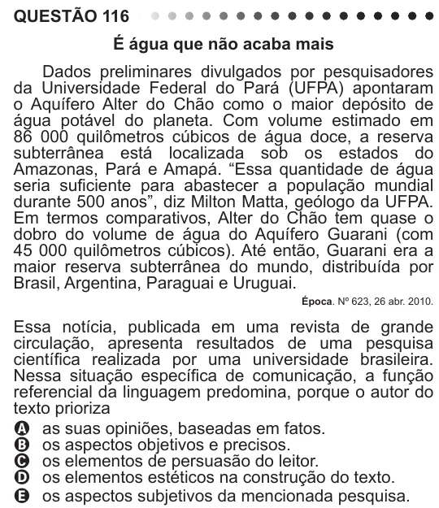

Texto extraído (pode conter ruído)

QUESTÃO 116  
É água que não acaba mais  
Dados preliminares divulgados por pesquisadores  
da Universidade Federal do Pará (UFPA) apontaram  
o Aquífero Alter do Chão como o maior depósito de  
água potável do planeta. Com volume estimado em  
86 000 quilômetros cúbicos de água doce, a reserva  
subterrânea está localizada sob os estados do  
Amazonas, Pará e Amapá. “Essa quantidade de água  
seria suficiente para abastecer a população mundial  
durante 500 anos”, diz Milton Matta, geólogo da UFPA.  
Em termos comparativos, Alter do Chão tem quase o  
dobro do volume de água do Aquífero Guarani (com  
45 000 quilômetros cúbicos). Até então, Guarani era a  
maior reserva subterrânea do mundo, distribuída por  
Brasil, Argentina, Paraguai e Uruguai.  
Época. Nº 623, 26 abr. 2010.  
Essa notícia, publicada em uma revista de grande  
circulação, apresenta resultados de uma pesquisa  
científica realizada por uma universidade brasileira.  
Nessa situação específica de comunicação, a função  
referencial da linguagem predomina, porque o autor do  
texto prioriza  
A as suas opiniões, baseadas em fatos.  
B os aspectos objetivos e precisos.  
C os elementos de persuasão do leitor.  
D os elementos estéticos na construção do texto.  
E os aspectos subjetivos da mencionada pesquisa.

