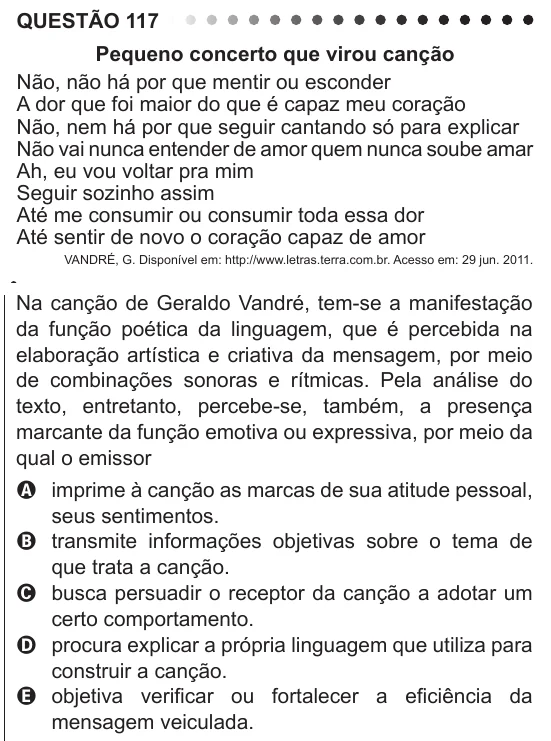

Texto extraído (pode conter ruído)

QUESTÃO 117  
Pequeno concerto que virou canção  
Não, não há por que mentir ou esconder  
A dor que foi maior do que é capaz meu coração  
Não, nem há por que seguir cantando só para explicar  
Não vai nunca entender de amor quem nunca soube amar  
Ah, eu vou voltar pra mim  
Seguir sozinho assim  
Até me consumir ou consumir toda essa dor  
Até sentir de novo o coração capaz de amor  
VANDRÉ, G. Disponível em: http://www.letras.terra.com.br. Acesso em: 29 jun. 2011.  
Na canção de Geraldo Vandré, tem-se a manifestação  
da função poética da linguagem, que é percebida na  
elaboração artística e criativa da mensagem, por meio  
de combinações sonoras e rítmicas. Pela análise do  
texto, entretanto, percebe-se, também, a presença  
marcante da função emotiva ou expressiva, por meio da  
qual o emissor  
A imprime à canção as marcas de sua atitude pessoal,  
seus sentimentos.  
B transmite informações objetivas sobre o tema de  
que trata a canção.  
C busca persuadir o receptor da canção a adotar um  
certo comportamento.  
D procura explicar a própria linguagem que utiliza para  
construir a canção.  
E objetiva verificar ou fortalecer a eficiência da  
mensagem veiculada.

