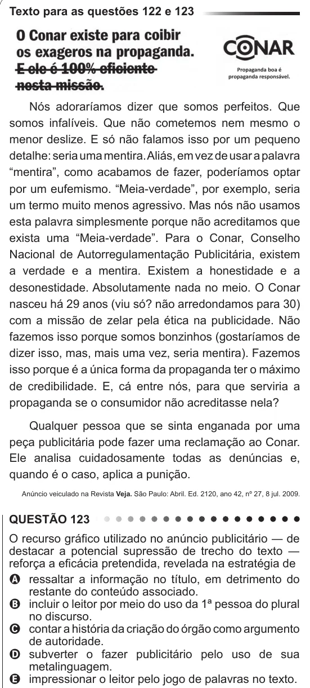

Texto extraído (pode conter ruído)

Texto para as questões 122 e 123  
Nós adoraríamos dizer que somos perfeitos. Que  
somos infalíveis. Que não cometemos nem mesmo o  
menor deslize. E só não falamos isso por um pequeno  
detalhe: seria uma mentira. Aliás, em vez de usar a palavra  
“mentira”, como acabamos de fazer, poderíamos optar  
por um eufemismo. “Meia-verdade”, por exemplo, seria  
um termo muito menos agressivo. Mas nós não usamos  
esta palavra simplesmente porque não acreditamos que  
exista uma “Meia-verdade”. Para o Conar, Conselho  
Nacional de Autorregulamentação Publicitária, existem  
a verdade e a mentira. Existem a honestidade e a  
desonestidade. Absolutamente nada no meio. O Conar  
nasceu há 29 anos (viu só? não arredondamos para 30)  
com a missão de zelar pela ética na publicidade. Não  
fazemos isso porque somos bonzinhos (gostaríamos de  
dizer isso, mas, mais uma vez, seria mentira). Fazemos  
isso porque é a única forma da propaganda ter o máximo  
de credibilidade. E, cá entre nós, para que serviria a  
propaganda se o consumidor não acreditasse nela?  
Qualquer pessoa que se sinta enganada por uma  
peça publicitária pode fazer uma reclamação ao Conar.  
Ele analisa cuidadosamente todas as denúncias e,  
quando é o caso, aplica a punição.  
Anúncio veiculado na Revista Veja. São Paulo: Abril. Ed. 2120, ano 42, nº 27, 8 jul. 2009.  
QUESTÃO 123  
O recurso gráfico utilizado no anúncio publicitário ― de  
destacar a potencial supressão de trecho do texto ―  
reforça a eficácia pretendida, revelada na estratégia de  
A ressaltar a informação no título, em detrimento do  
restante do conteúdo associado.  
B incluir o leitor por meio do uso da 1ª pessoa do plural  
no discurso.  
C contar a história da criação do órgão como argumento  
de autoridade.  
D subverter o fazer publicitário pelo uso de sua  
metalinguagem.  
E impressionar o leitor pelo jogo de palavras no texto.

