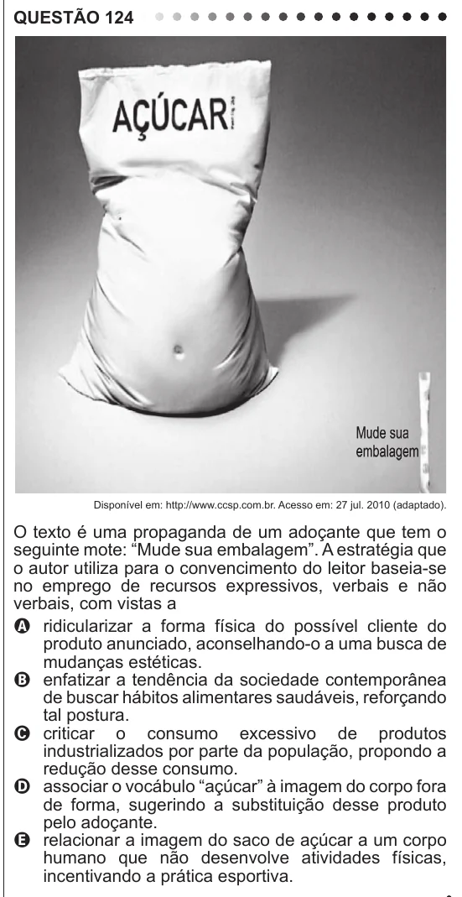

Texto extraído (pode conter ruído)

QUESTÃO 124  
Disponível em: http://www.ccsp.com.br. Acesso em: 27 jul. 2010 (adaptado).  
O texto é uma propaganda de um adoçante que tem o  
seguinte mote: “Mude sua embalagem”. A estratégia que  
o autor utiliza para o convencimento do leitor baseia-se  
no emprego de recursos expressivos, verbais e não  
verbais, com vistas a  
A ridicularizar a forma física do possível cliente do  
produto anunciado, aconselhando-o a uma busca de  
mudanças estéticas.  
B enfatizar a tendência da sociedade contemporânea  
de buscar hábitos alimentares saudáveis, reforçando  
tal postura.  
C criticar o consumo excessivo de produtos  
industrializados por parte da população, propondo a  
redução desse consumo.  
D associar o vocábulo “açúcar” à imagem do corpo fora  
de forma, sugerindo a substituição desse produto  
pelo adoçante.  
E relacionar a imagem do saco de açúcar a um corpo  
humano que não desenvolve atividades físicas,  
incentivando a prática esportiva.

