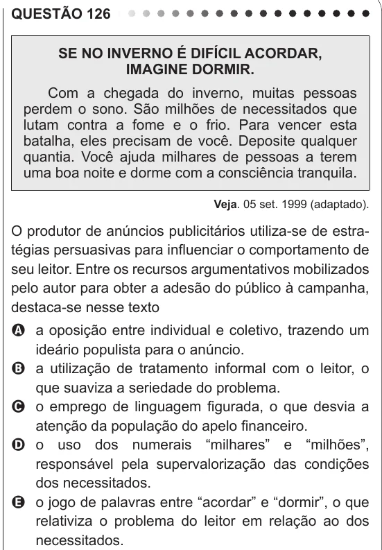

Texto extraído (pode conter ruído)

QUESTÃO 126  
SE NO INVERNO É DIFÍCIL ACORDAR,  
IMAGINE DORMIR.  
Com a chegada do inverno, muitas pessoas  
perdem o sono. São milhões de necessitados que  
lutam contra a fome e o frio. Para vencer esta  
batalha, eles precisam de você. Deposite qualquer  
quantia. Você ajuda milhares de pessoas a terem  
uma boa noite e dorme com a consciência tranquila.  
Veja. 05 set. 1999 (adaptado).  
O produtor de anúncios publicitários utiliza-se de estra-  
tégias persuasivas para influenciar o comportamento de  
seu leitor. Entre os recursos argumentativos mobilizados  
pelo autor para obter a adesão do público à campanha,  
destaca-se nesse texto  
A a oposição entre individual e coletivo, trazendo um  
ideário populista para o anúncio.  
B a utilização de tratamento informal com o leitor, o  
que suaviza a seriedade do problema.  
C o emprego de linguagem figurada, o que desvia a  
atenção da população do apelo financeiro.  
D o uso dos numerais “milhares” e “milhões”,  
responsável pela supervalorização das condições  
dos necessitados.  
E o jogo de palavras entre “acordar” e “dormir”, o que  
relativiza o problema do leitor em relação ao dos  
necessitados.

