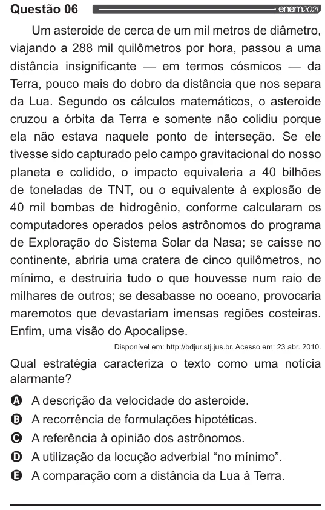

Texto extraído (pode conter ruído)

Questão 06  
y  
Um asteroide de cerca de um mil metros de diâmetro,  
viajando a 288 mil quilômetros por hora, passou a uma  
distância insignificante — em termos cósmicos — da  
Terra, pouco mais do dobro da distância que nos separa  
da Lua. Segundo os cálculos matemáticos, o asteroide  
cruzou a órbita da Terra e somente não colidiu porque  
ela não estava naquele ponto de interseção. Se ele  
tivesse sido capturado pelo campo gravitacional do nosso  
planeta e colidido, o impacto equivaleria a 40 bilhões  
de toneladas de TNT, ou o equivalente à explosão de  
40 mil bombas de hidrogênio, conforme calcularam os  
computadores operados pelos astrônomos do programa  
de Exploração do Sistema Solar da Nasa; se caísse no  
continente, abriria uma cratera de cinco quilômetros, no  
mínimo, e destruiria tudo o que houvesse num raio de  
milhares de outros; se desabasse no oceano, provocaria  
maremotos que devastariam imensas regiões costeiras.  
Enfim, uma visão do Apocalipse.  
Disponível em: http://bdjur.stj jus.br. Acesso em: 23 abr. 2010.  
Qual estratégia caracteriza o texto como uma notícia  
alarmante?  
VOOS  
A descrição da velocidade do asteroide.  
A recorrência de formulações hipotéticas.  
A referência à opinião dos astrônomos.  
A utilização da locução adverbial “no mínimo”.  
A comparação com a distância da Lua à Terra.

