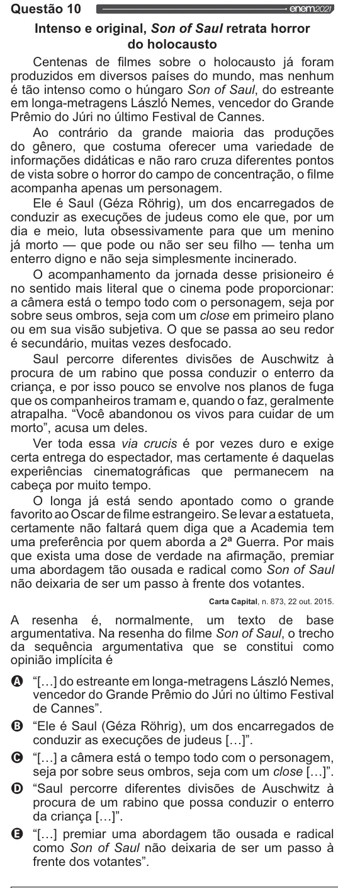

Texto extraído (pode conter ruído)

Questão 10  
Intenso e original, Son of Saul retrata horror  
do holocausto  
Centenas de filmes sobre o holocausto já foram  
produzidos em diversos países do mundo, mas nenhum  
é tão intenso como o húngaro Son of Saul, do estreante  
em longa-metragens László Nemes, vencedor do Grande  
Prêmio do Júri no último Festival de Cannes.  
Ao contrário da grande maioria das produções  
do gênero, que costuma oferecer uma variedade de  
informações didáticas e não raro cruza diferentes pontos  
de vista sobre o horror do campo de concentração, o filme  
acompanha apenas um personagem.  
Ele é Saul (Géza Rôhrig), um dos encarregados de  
conduzir as execuções de judeus como ele que, por um  
dia e meio, luta obsessivamente para que um menino  
já morto — que pode ou não ser seu filho — tenha um  
enterro digno e não seja simplesmente incinerado.  
O acompanhamento da jornada desse prisioneiro é  
no sentido mais literal que o cinema pode proporcionar:  
a câmera está o tempo todo com o personagem, seja por  
sobre seus ombros, seja com um close em primeiro plano  
ou em sua visão subjetiva. O que se passa ao seu redor  
é secundário, muitas vezes desfocado.  
Saul percorre diferentes divisões de Auschwitz à  
procura de um rabino que possa conduzir o enterro da  
criança, e por isso pouco se envolve nos planos de fuga  
que os companheiros tramam e, quando o faz, geralmente  
atrapalha. “Você abandonou os vivos para cuidar de um  
morto”, acusa um deles.  
Ver toda essa via crucis é por vezes duro e exige  
certa entrega do espectador, mas certamente é daquelas  
experiências cinematográficas que permanecem na  
cabeça por muito tempo.  
O longa já está sendo apontado como o grande  
favorito ao Oscar de filme estrangeiro. Se levar a estatueta,  
certamente não faltará quem diga que a Academia tem  
uma preferência por quem aborda a 2º Guerra. Por mais  
que exista uma dose de verdade na afirmação, premiar  
uma abordagem tão ousada e radical como Son of Saul  
não deixaria de ser um passo à frente dos votantes.  
Carta Capital, n. 873, 22 out. 2015.  
A resenha é, normalmente, um texto de base  
argumentativa. Na resenha do filme Son of Saul, o trecho  
da sequência argumentativa que se constitui como  
opinião implícita é  
O “[...] do estreante em longa-metragens Lászió Nemes,  
vencedor do Grande Prêmio do Júri no último Festival  
de Cannes”.  
O “Ele é Saul (Géza Róhrig), um dos encarregados de  
conduzir as execuções de judeus [...)”.  
O “[...] a câmera está o tempo todo com o personagem,  
seja por sobre seus ombros, seja com um close [...]”.  
O “Saul percorre diferentes divisões de Auschwitz à  
procura de um rabino que possa conduzir o enterro  
da criança [...]”.  
O “[...] premiar uma abordagem tão ousada e radical  
como Son of Saul não deixaria de ser um passo à  
frente dos votantes”.

