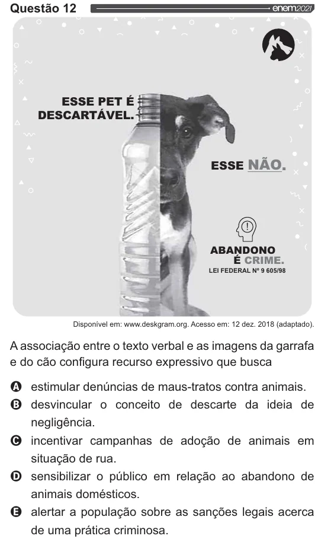

Texto extraído (pode conter ruído)

Questão 12  
ESSE PET É  
DESCARTÁVEL.  
ESSE NÃO.  
ABANDONO  
É CRIME.  
LEI FEDERAL Nº 9 605/98  
Disponível em: www.deskgram.org. Acesso em: 12 dez. 2018 (adaptado).  
Aassociação entre o texto verbal e as imagens da garrafa  
e do cão configura recurso expressivo que busca  
OQ estimular denúncias de maus-tratos contra animais.  
O desvincular o conceito de descarte da  
ideia de  
negligência.  
O incentivar campanhas de adoção de animais em  
situação de rua.  
O sensibilizar o público em relação ao abandono de  
animais domésticos.  
Q alertar a população sobre as sanções legais acerca  
de uma prática criminosa.

