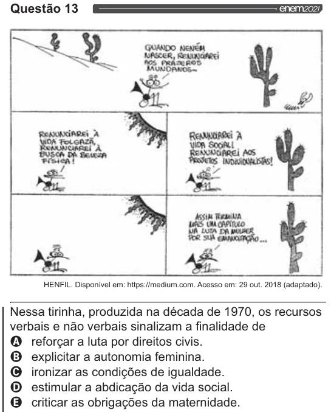

Texto extraído (pode conter ruído)

Questão 13  
au?  
En  
ENSRER ya  
|  
CA DÊ Bercza AUNTAREI AOS  
POsicA! t  
ei Ag  
4 E,  
| Ago Agir  
E sa”  
HENFIL. Disponível em: https://medium.com. Acesso em: 29 out. 2018 (adaptado).  
Nessa tirinha, produzida na década de 1970, os recursos  
verbais e não verbais sinalizam a finalidade de  
OQ reforçar a luta por direitos civis.  
O explicitar a autonomia feminina.  
O ironizar as condições de igualdade.  
O estimular a abdicação da vida social.  
Q criticar as obrigações da maternidade.

