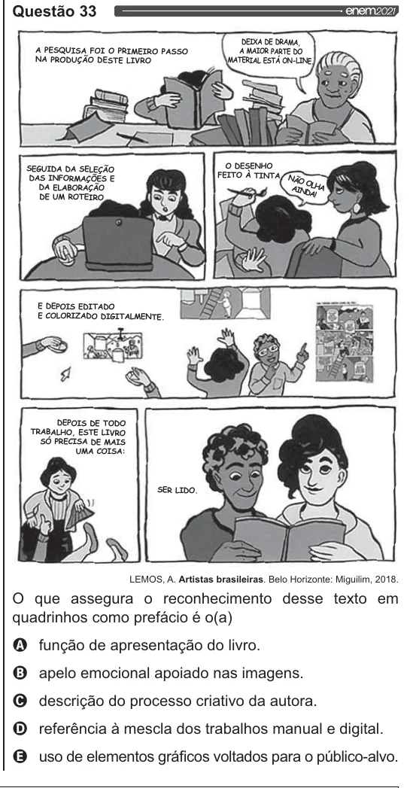

Texto extraído (pode conter ruído)

Questão 33  
A PESQUISA FOI O PRIMEIRO PASSO  
NA PRODUÇÃO DESTE LIVRO  
SEGUIDA DA SELEÇÃO FEITO À TINTA,  
O DESENHO  
DAS INFORMAÇÕES E  
DA ELABORAÇÃO  
DE UM ROTEIRO  
E DEPOIS EDITADO  
E COLORIZADO DIGITALMENTE.  
DEPOIS DE TODO  
TRABALHO, ESTE LIVRO  
SÓ PRECISA DE MAIS  
UMA COISA:  
LEMOS, A. Artistas brasileiras. Belo Horizonte: Miguilim, 2018.  
O que assegura o reconhecimento desse texto em  
quadrinhos como prefácio é o(a)  
Q função de apresentação do livro.  
O apelo emocional apoiado nas imagens.  
O descrição do processo criativo da autora.  
O referência à mescla dos trabalhos manual e digital.  
& uso de elementos gráficos voltados para o público-alvo.

