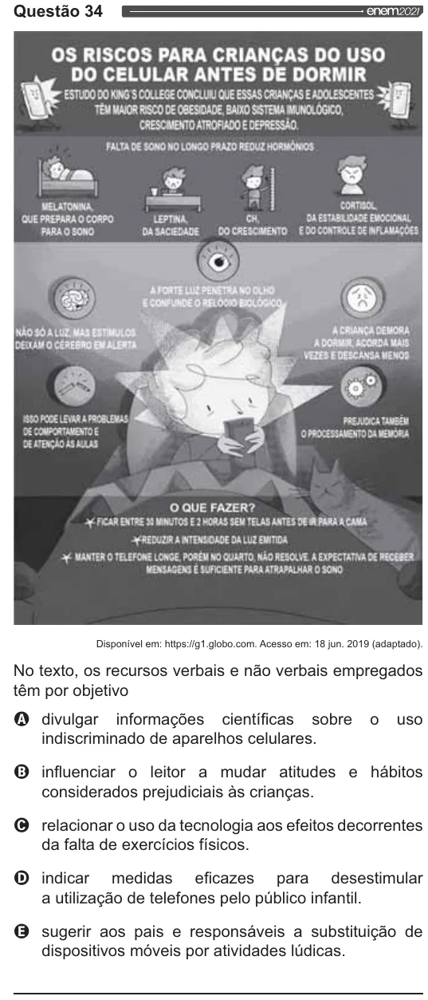

Texto extraído (pode conter ruído)

Questão 34  
OS RISCOS PARA CRIANÇAS DO USO  
DO CELULAR ANTES DE DORMIR  
ve ESTUDO DO KING S COLLEGE CONCLUN QUE ESSAS CRIANÇAS E ADOLESCENTE  
TÊM MAIOR RSCO DE OBESIDADE, BAIXO SISTEMA IMUNOLÓGICO  
CRESCIMENTO ATROFIADO E DEPRESSÃO.  
FALTA DE SONO NO LONGO PRAZO REDUZ HORMÔNIOS  
EA  
se  
EB  
& |  
4  
jr  
[o  
MELATONINA,  
1 CORSO.  
LEPTINA, cu DA ESTABILIDADE EMOCIONAL  
QUE PREPARA O CORPO  
PARA O SONO  
SACIED, CRESCIMENTO E DO CONTROLE DE INFLAMAÇÕES  
O QUE FAZER?  
FICAR ENTRE 34 MINUTOS E 2 HORAS SEM TELAS ANTES DER PARA R CAMA  
REDUZIR À INTENSIDADE DA LUZ EMITIDA  
é MANTER O TELEFONE LONGE. EM NO QU NÃO RESOLVE A EXPECTATIVA DE RECESER  
MENSAGENS É SUFICIENTE PARA ATRAPALHAR O SONO  
Disponível em: https://91 globo.com. Acesso em: 18 jun. 2019 (adaptado).  
No texto, os recursos verbais e não verbais empregados  
têm por objetivo  
O divulgar informações científicas sobre o uso  
indiscriminado de aparelhos celulares.  
O influenciar o leitor a mudar atitudes e hábitos  
considerados prejudiciais às crianças.  
O relacionar o uso da tecnologia aos efeitos decorrentes  
da falta de exercícios físicos.  
O indicar medidas eficazes para desestimular  
a utilização de telefones pelo público infantil.  
O sugerir aos pais e responsáveis a substituição de  
dispositivos móveis por atividades lúdicas.

