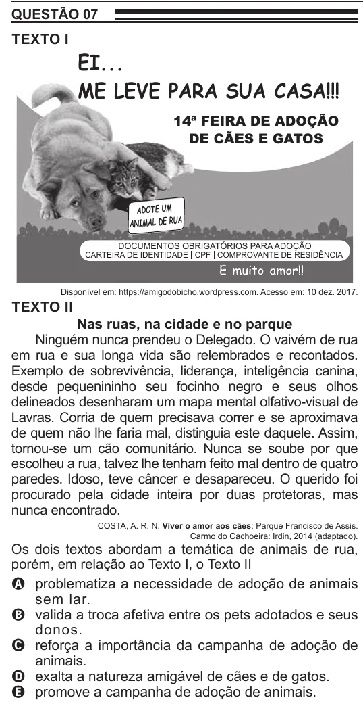

Texto extraído (pode conter ruído)

QUESTÃO 07  
TEXTO I  
EI...  
ME LEVE PARA SUA CASA!!!  
14ª FEIRA DE ADOÇÃO  
DE CÃES E GATOS  
ADOTE UM  
ANIMAL DE RUA  
DOCUMENTOS OBRIGATÓRIOS PARA ADOÇÃO  
CARTEIRA DE IDENTIDADE CPF COMPROVANTE DE RESIDÊNCIA  
E muito amor!!  
Disponível em: https://amigodobicho.wordpress.com. Acesso em: 10 dez. 2017.  
TEXTO II  
Nas ruas, na cidade e no parque  
Ninguém nunca prendeu o Delegado. O vaivém de rua  
em rua e sua longa vida são relembrados e recontados.  
Exemplo de sobrevivência, liderança, inteligência canina,  
desde pequenininho seu focinho negro e seus olhos  
delineados desenharam um mapa mental olfativo-visual de  
Lavras. Corria de quem precisava correr e se aproximava  
de quem não lhe faria mal, distinguia este daquele. Assim,  
tornou-se um cão comunitário. Nunca se soube por que  
escolheu a rua, talvez lhe tenham feito mal dentro de quatro  
paredes. Idoso, teve câncer e desapareceu. O querido foi  
procurado pela cidade inteira por duas protetoras, mas  
nunca encontrado.  
COSTA, A. R. N. Viver o amor aos cães: Parque Francisco de Assis.  
Carmo do Cachoeira: Irdin, 2014 (adaptado).  
Os dois textos abordam a temática de animais de rua,  
porém, em relação ao Texto I, o Texto II  
A problematiza a necessidade de adoção de animais  
sem lar.  
B valida a troca afetiva entre os pets adotados e seus  
donos.  
C reforça a importância da campanha de adoção de  
animais.  
D exalta a natureza amigável de cães e de gatos.  
E promove a campanha de adoção de animais.

