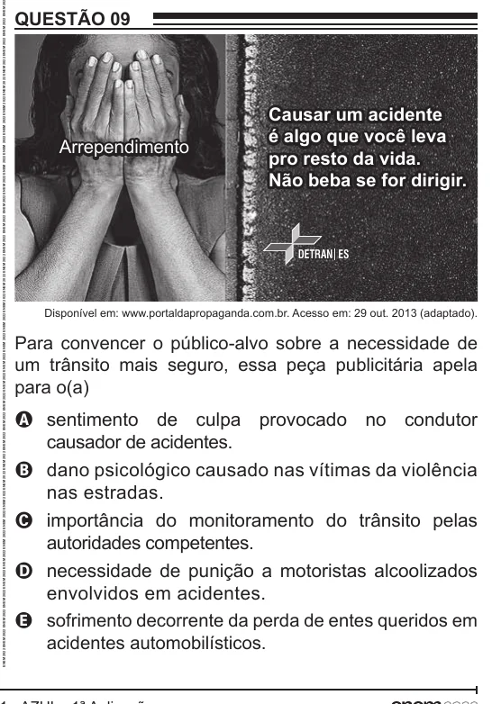

Texto extraído (pode conter ruído)

QUESTÃO 09  
Causar um acidente  
é algo que você leva  
Arrependimento  
pro resto da vida.  
Não beba se for dirigir.  
DETRAN ES  
Disponível em: www.portaldapropaganda.com.br. Acesso em: 29 out. 2013 (adaptado).  
Para convencer o público-alvo sobre a necessidade de  
um trânsito mais seguro, essa peça publicitária apela  
para o(a)  
A sentimento de culpa provocado no condutor  
causador de acidentes.  
B dano psicológico causado nas vítimas da violência  
nas estradas.  
C importância do monitoramento do trânsito pelas  
autoridades competentes.  
D necessidade de punição a motoristas alcoolizados  
envolvidos em acidentes.  
E sofrimento decorrente da perda de entes queridos em  
acidentes automobilísticos.

