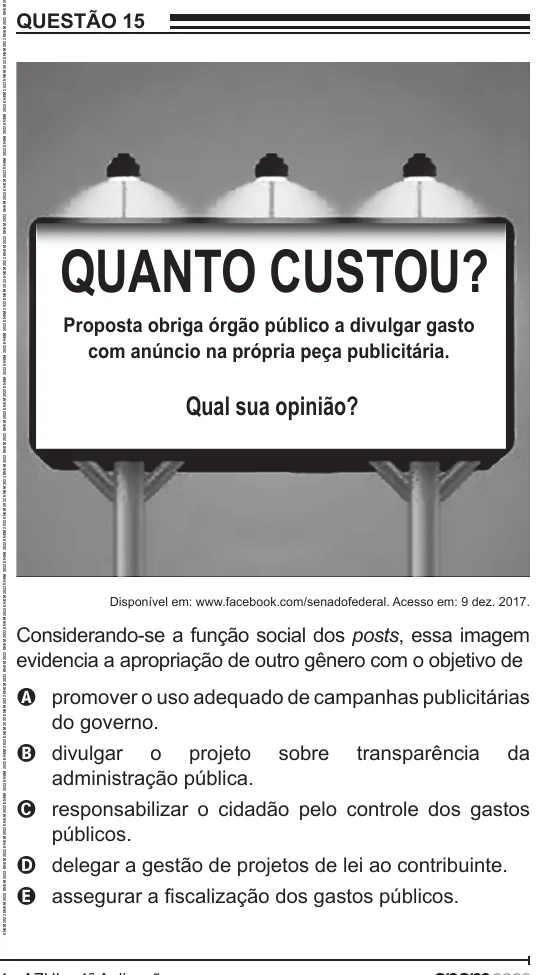

Texto extraído (pode conter ruído)

QUESTÃO 15  
QUANTO CUSTOU?  
Proposta obriga órgão público a divulgar gasto  
com anúncio na própria peça publicitária.  
Qual sua opinião?  
Disponível em: www.facebook.com/senadofederal. Acesso em: 9 dez. 2017.  
Considerando-se a função social dos posts, essa imagem  
evidencia a apropriação de outro gênero com o objetivo de  
A promover o uso adequado de campanhas publicitárias  
do governo.  
B divulgar o projeto  
sobre  
transparência  
da  
administração pública.  
C responsabilizar o cidadão pelo controle dos gastos  
públicos.  
D delegar a gestão de projetos de lei ao contribuinte.  
E assegurar a fiscalização dos gastos públicos.

