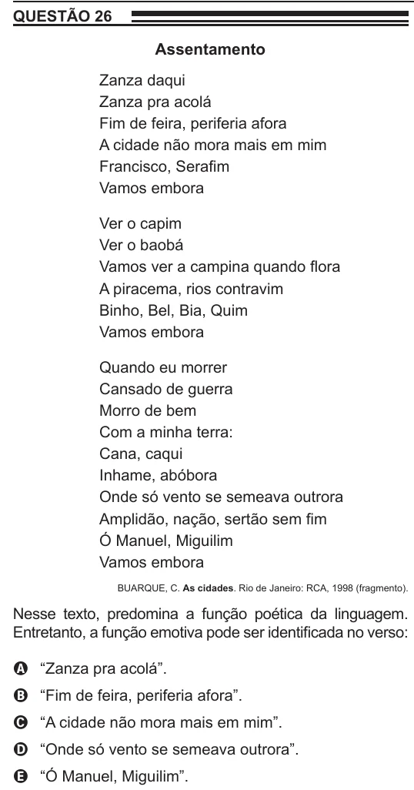

Texto extraído (pode conter ruído)

QUESTÃO 26  
Assentamento  
Zanza daqui  
Zanza pra acolá  
Fim de feira, periferia afora  
A cidade não mora mais em mim  
Francisco, Serafim  
Vamos embora  
Ver o capim  
Ver o baobá  
Vamos ver a campina quando flora  
A piracema, rios contravim  
Binho, Bel, Bia, Quim  
Vamos embora  
Quando eu morrer  
Cansado de guerra  
Morro de bem  
Com a minha terra:  
Cana, caqui  
Inhame, abóbora  
Onde só vento se semeava outrora  
Amplidão, nação, sertão sem fim  
Ó Manuel, Miguilim  
Vamos embora  
BUARQUE, C. As cidades. Rio de Janeiro: RCA, 1998 (fragmento).  
Nesse texto, predomina a função poética da linguagem.  
Entretanto, a função emotiva pode ser identificada no verso:  
A “Zanza pra acolá”.  
B “Fim de feira, periferia afora”.  
C “A cidade não mora mais em mim”.  
D “Onde só vento se semeava outrora”.  
E “Ó Manuel, Miguilim”.

