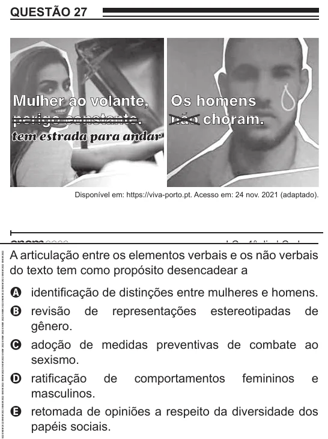

Texto extraído (pode conter ruído)

QUESTÃO 27  
Mulher ao volante,  
Os homens  
perigo constante.  
não choram.  
tem estrada para andar  
Disponível em: https://viva-porto.pt. Acesso em: 24 nov. 2021 (adaptado).  
A articulação entre os elementos verbais e os não verbais  
do texto tem como propósito desencadear a  
A identificação de distinções entre mulheres e homens.  
B revisão de  
representações  
estereotipadas  
de  
gênero.  
C adoção de medidas preventivas de combate ao  
sexismo.  
D ratificação de  
comportamentos  
femininos  
e  
masculinos.  
E retomada de opiniões a respeito da diversidade dos  
papéis sociais.

