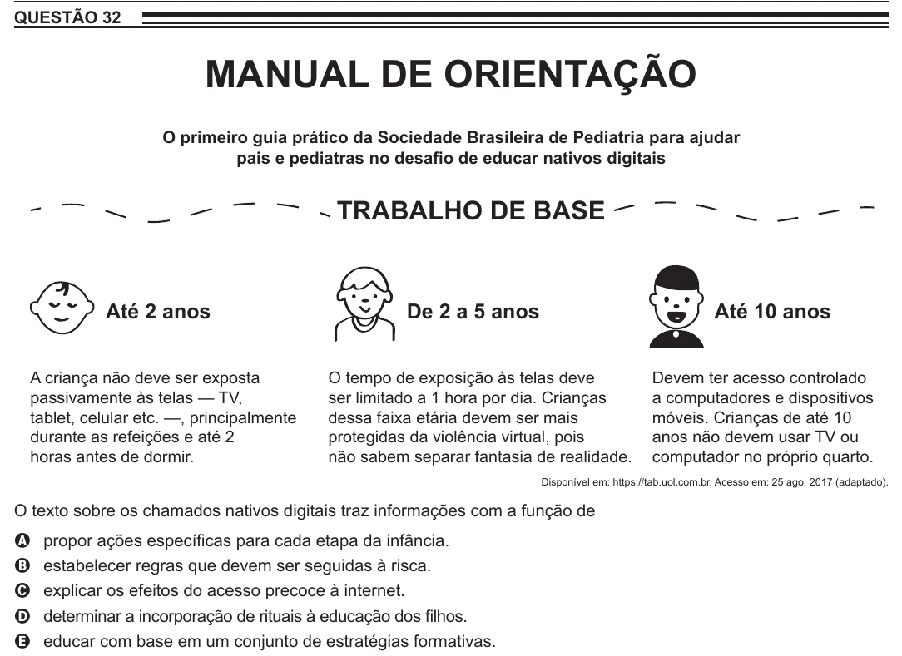

Texto extraído (pode conter ruído)

QUESTÃO 32  
MANUAL DE ORIENTAÇÃO  
O primeiro guia prático da Sociedade Brasileira de Pediatria para ajudar  
pais e pediatras no desafio de educar nativos digitais  
TRABALHO DE BASE  
Até 2 anos  
De 2 a 5 anos  
Até 10 anos  
A criança não deve ser exposta  
O tempo de exposição às telas deve  
Devem ter acesso controlado  
passivamente às telas — TV,  
ser limitado a 1 hora por dia. Crianças  
a computadores e dispositivos  
tablet, celular etc. —, principalmente  
dessa faixa etária devem ser mais  
móveis. Crianças de até 10  
durante as refeições e até 2  
protegidas da violência virtual, pois  
anos não devem usar TV ou  
horas antes de dormir.  
não sabem separar fantasia de realidade.  
computador no próprio quarto.  
Disponível em: https://tab.uol.com.br. Acesso em: 25 ago. 2017 (adaptado).  
O texto sobre os chamados nativos digitais traz informações com a função de  
propor ações específicas para cada etapa da infância.  
A  
estabelecer regras que devem ser seguidas à risca.  
B  
explicar os efeitos do acesso precoce à internet.  
C  
determinar a incorporação de rituais à educação dos filhos.  
D  
E  
educar com base em um conjunto de estratégias formativas.

