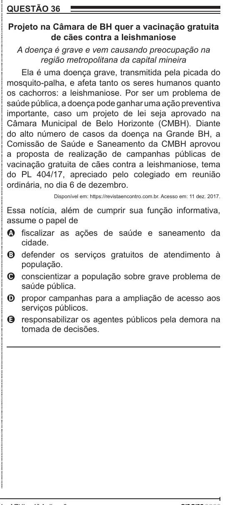

Texto extraído (pode conter ruído)

QUESTÃO 36  
Projeto na Câmara de BH quer a vacinação gratuita  
de cães contra a leishmaniose  
A doença é grave e vem causando preocupação na  
região metropolitana da capital mineira  
Ela é uma doença grave, transmitida pela picada do  
mosquito-palha, e afeta tanto os seres humanos quanto  
os cachorros: a leishmaniose. Por ser um problema de  
saúde pública, a doença pode ganhar uma ação preventiva  
importante, caso um projeto de lei seja aprovado na  
Câmara Municipal de Belo Horizonte (CMBH). Diante  
do alto número de casos da doença na Grande BH, a  
Comissão de Saúde e Saneamento da CMBH aprovou  
a proposta de realização de campanhas públicas de  
vacinação gratuita de cães contra a leishmaniose, tema  
do PL 404/17, apreciado pelo colegiado em reunião  
ordinária, no dia 6 de dezembro.  
Disponível em: https://revistaencontro.com.br. Acesso em: 11 dez. 2017.  
Essa notícia, além de cumprir sua função informativa,  
assume o papel de  
A fiscalizar as ações de saúde e saneamento da  
cidade.  
B defender os serviços gratuitos de atendimento à  
população.  
C conscientizar a população sobre grave problema de  
saúde pública.  
D propor campanhas para a ampliação de acesso aos  
serviços públicos.  
E responsabilizar os agentes públicos pela demora na  
tomada de decisões.

