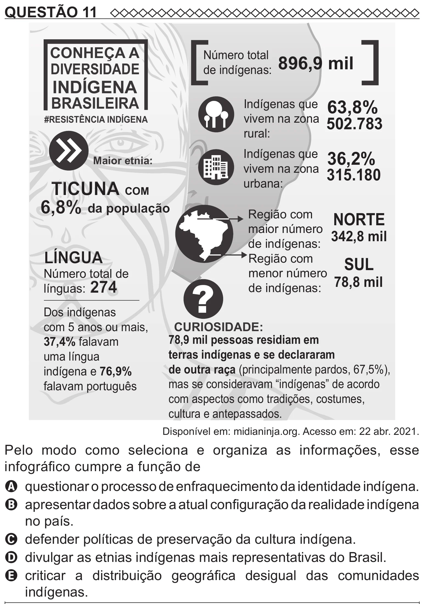

Texto extraído (pode conter ruído)

QUESTÃO 11  
CONHEÇA A  
Número total  
de indígenas: 896,9 mil  
DIVERSIDADE  
INDÍGENA  
BRASILEIRA  
Indígenas que 63,8%  
vivem na zona  
502.783  
#RESISTÊNCIA INDÍGENA  
rural:  
Indígenas que  
36,2%  
Maior etnia:  
vivem na zona  
315.180  
TICUNA COM  
urbana:  
6,8% da população  
Região com  
NORTE  
maior número  
342,8 mil  
de indígenas:  
LÍNGUA  
Região com  
SUL  
Número total de  
menor número  
?  
de indígenas: 78,8 mil  
línguas: 274  
Dos indígenas  
com 5 anos ou mais,  
CURIOSIDADE:  
78,9 mil pessoas residiam em  
37,4% falavam  
terras indígenas e se declararam  
uma língua  
de outra raça (principalmente pardos, 67,5%),  
indígena e 76,9%  
mas se consideravam “indígenas” de acordo  
falavam português  
com aspectos como tradições, costumes,  
cultura e antepassados.  
Disponível em: midianinja.org. Acesso em: 22 abr. 2021.  
Pelo modo como seleciona e organiza as informações, esse  
infográfico cumpre a função de  
A questionar o processo de enfraquecimento da identidade indígena.  
B apresentar dados sobre a atual configuração da realidade indígena  
no país.  
C defender políticas de preservação da cultura indígena.  
D divulgar as etnias indígenas mais representativas do Brasil.  
E criticar a distribuição geográfica desigual das comunidades  
indígenas.

