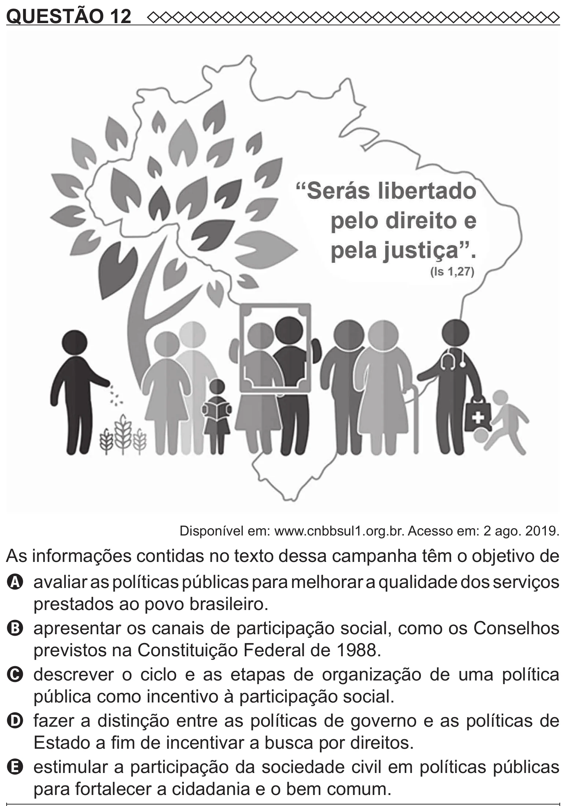

Texto extraído (pode conter ruído)

QUESTÃO 12  
Disponível em: www.cnbbsul1.org.br. Acesso em: 2 ago. 2019.  
As informações contidas no texto dessa campanha têm o objetivo de  
A avaliar as políticas públicas para melhorar a qualidade dos serviços  
prestados ao povo brasileiro.  
B apresentar os canais de participação social, como os Conselhos  
previstos na Constituição Federal de 1988.  
C descrever o ciclo e as etapas de organização de uma política  
pública como incentivo à participação social.  
D fazer a distinção entre as políticas de governo e as políticas de  
Estado a fim de incentivar a busca por direitos.  
E estimular a participação da sociedade civil em políticas públicas  
para fortalecer a cidadania e o bem comum.

