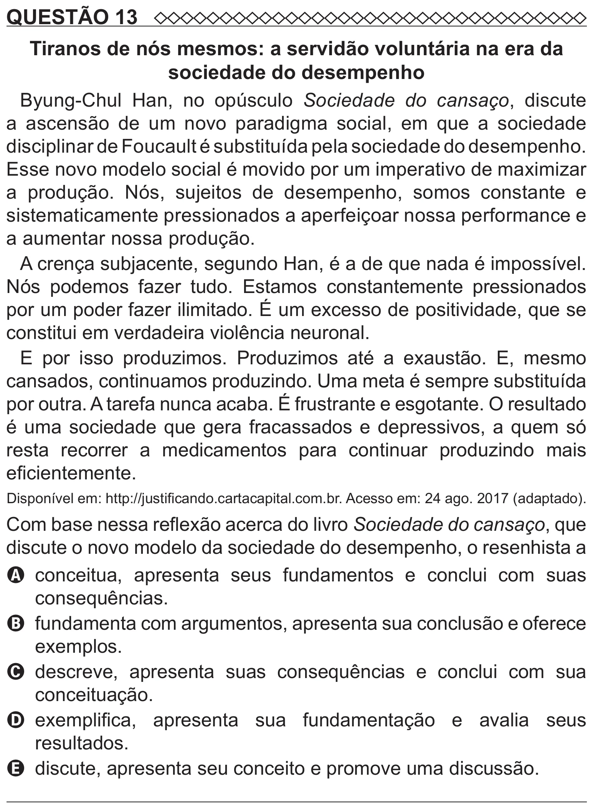

Texto extraído (pode conter ruído)

QUESTÃO 13  
Tiranos de nós mesmos: a servidão voluntária na era da  
sociedade do desempenho  
Byung-Chul Han, no opúsculo Sociedade do cansaço, discute  
a ascensão de um novo paradigma social, em que a sociedade  
disciplinar de Foucault é substituída pela sociedade do desempenho.  
Esse novo modelo social é movido por um imperativo de maximizar  
a produção. Nós, sujeitos de desempenho, somos constante e  
sistematicamente pressionados a aperfeiçoar nossa performance e  
a aumentar nossa produção.  
A crença subjacente, segundo Han, é a de que nada é impossível.  
Nós podemos fazer tudo. Estamos constantemente pressionados  
por um poder fazer ilimitado. É um excesso de positividade, que se  
constitui em verdadeira violência neuronal.  
E por isso produzimos. Produzimos até a exaustão. E, mesmo  
cansados, continuamos produzindo. Uma meta é sempre substituída  
por outra. A tarefa nunca acaba. É frustrante e esgotante. O resultado  
é uma sociedade que gera fracassados e depressivos, a quem só  
resta recorrer a medicamentos para continuar produzindo mais  
eficientemente.  
Disponível em: http://justificando.cartacapital.com.br. Acesso em: 24 ago. 2017 (adaptado).  
Com base nessa reflexão acerca do livro Sociedade do cansaço, que  
discute o novo modelo da sociedade do desempenho, o resenhista a  
A   
conceitua, apresenta seus fundamentos e conclui com suas  
consequências.  
B fundamenta com argumentos, apresenta sua conclusão e oferece  
exemplos.  
C   
descreve, apresenta suas consequências e conclui com sua  
conceituação.  
D exemplifica, apresenta sua fundamentação e avalia seus  
resultados.  
E discute, apresenta seu conceito e promove uma discussão.

