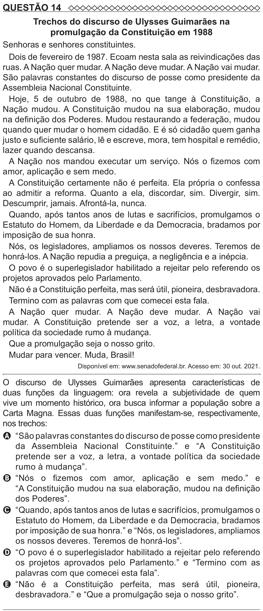

Texto extraído (pode conter ruído)

QUESTÃO 14  
Trechos do discurso de Ulysses Guimarães na  
promulgação da Constituição em 1988  
Senhoras e senhores constituintes.  
Dois de fevereiro de 1987. Ecoam nesta sala as reivindicações das  
ruas. A Nação quer mudar. A Nação deve mudar. A Nação vai mudar.  
São palavras constantes do discurso de posse como presidente da  
Assembleia Nacional Constituinte.  
Hoje, 5 de outubro de 1988, no que tange à Constituição, a  
Nação mudou. A Constituição mudou na sua elaboração, mudou  
na definição dos Poderes. Mudou restaurando a federação, mudou  
quando quer mudar o homem cidadão. E é só cidadão quem ganha  
justo e suficiente salário, lê e escreve, mora, tem hospital e remédio,  
lazer quando descansa.  
A Nação nos mandou executar um serviço. Nós o fizemos com  
amor, aplicação e sem medo.  
A Constituição certamente não é perfeita. Ela própria o confessa  
ao admitir a reforma. Quanto a ela, discordar, sim. Divergir, sim.  
Descumprir, jamais. Afrontá-la, nunca.  
Quando, após tantos anos de lutas e sacrifícios, promulgamos o  
Estatuto do Homem, da Liberdade e da Democracia, bradamos por  
imposição de sua honra.  
Nós, os legisladores, ampliamos os nossos deveres. Teremos de  
honrá-los. A Nação repudia a preguiça, a negligência e a inépcia.  
O povo é o superlegislador habilitado a rejeitar pelo referendo os  
projetos aprovados pelo Parlamento.  
Não é a Constituição perfeita, mas será útil, pioneira, desbravadora.  
Termino com as palavras com que comecei esta fala.  
A Nação quer mudar. A Nação deve mudar. A Nação vai  
mudar. A Constituição pretende ser a voz, a letra, a vontade  
política da sociedade rumo à mudança.  
Que a promulgação seja o nosso grito.  
Mudar para vencer. Muda, Brasil!  
Disponível em: www.senadofederal.br. Acesso em: 30 out. 2021.  
O discurso de Ulysses Guimarães apresenta características de  
duas funções da linguagem: ora revela a subjetividade de quem  
vive um momento histórico, ora busca informar a população sobre a  
Carta Magna. Essas duas funções manifestam-se, respectivamente,  
nos trechos:  
A “São palavras constantes do discurso de posse como presidente  
da Assembleia Nacional Constituinte.” e “A Constituição  
pretende ser a voz, a letra, a vontade política da sociedade  
rumo à mudança”.  
B “Nós o fizemos com amor, aplicação e sem medo.” e  
“A Constituição mudou na sua elaboração, mudou na definição  
dos Poderes”.  
C “Quando, após tantos anos de lutas e sacrifícios, promulgamos o  
Estatuto do Homem, da Liberdade e da Democracia, bradamos  
por imposição de sua honra.” e “Nós, os legisladores, ampliamos  
os nossos deveres. Teremos de honrá-los”.  
D “O povo é o superlegislador habilitado a rejeitar pelo referendo  
os projetos aprovados pelo Parlamento.” e “Termino com as  
palavras com que comecei esta fala”.  
E   
“Não é a Constituição perfeita, mas será útil, pioneira,  
desbravadora.” e “Que a promulgação seja o nosso grito”.

