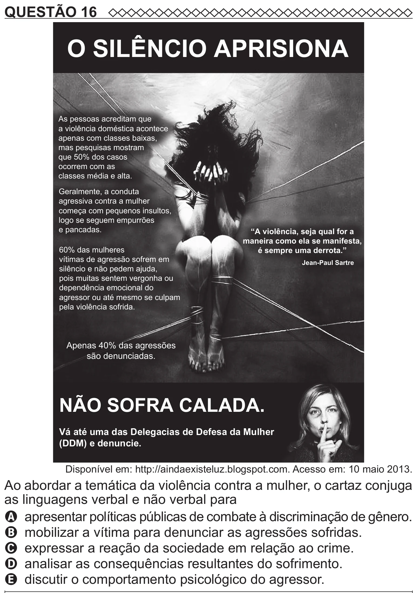

Texto extraído (pode conter ruído)

QUESTÃO 16  
O SILÊNCIO APRISIONA  
As pessoas acreditam que  
a violência doméstica acontece  
apenas com classes baixas,  
mas pesquisas mostram  
que 50% dos casos  
ocorrem com as  
classes média e alta.  
Geralmente, a conduta  
agressiva contra a mulher  
começa com pequenos insultos,  
logo se seguem empurrões  
e pancadas.  
“A violência, seja qual for a  
maneira como ela se manifesta,  
60% das mulheres  
é sempre uma derrota.”  
vítimas de agressão sofrem em  
Jean-Paul Sartre  
silêncio e não pedem ajuda,  
pois muitas sentem vergonha ou  
dependência emocional do  
agressor ou até mesmo se culpam  
pela violência sofrida.  
Apenas 40% das agressões  
são denunciadas.  
NÃO SOFRA CALADA.  
Vá até uma das Delegacias de Defesa da Mulher  
(DDM) e denuncie.  
Disponível em: http://aindaexisteluz.blogspot.com. Acesso em: 10 maio 2013.  
Ao abordar a temática da violência contra a mulher, o cartaz conjuga  
as linguagens verbal e não verbal para  
A apresentar políticas públicas de combate à discriminação de gênero.  
B mobilizar a vítima para denunciar as agressões sofridas.  
C expressar a reação da sociedade em relação ao crime.  
D analisar as consequências resultantes do sofrimento.  
E discutir o comportamento psicológico do agressor.

