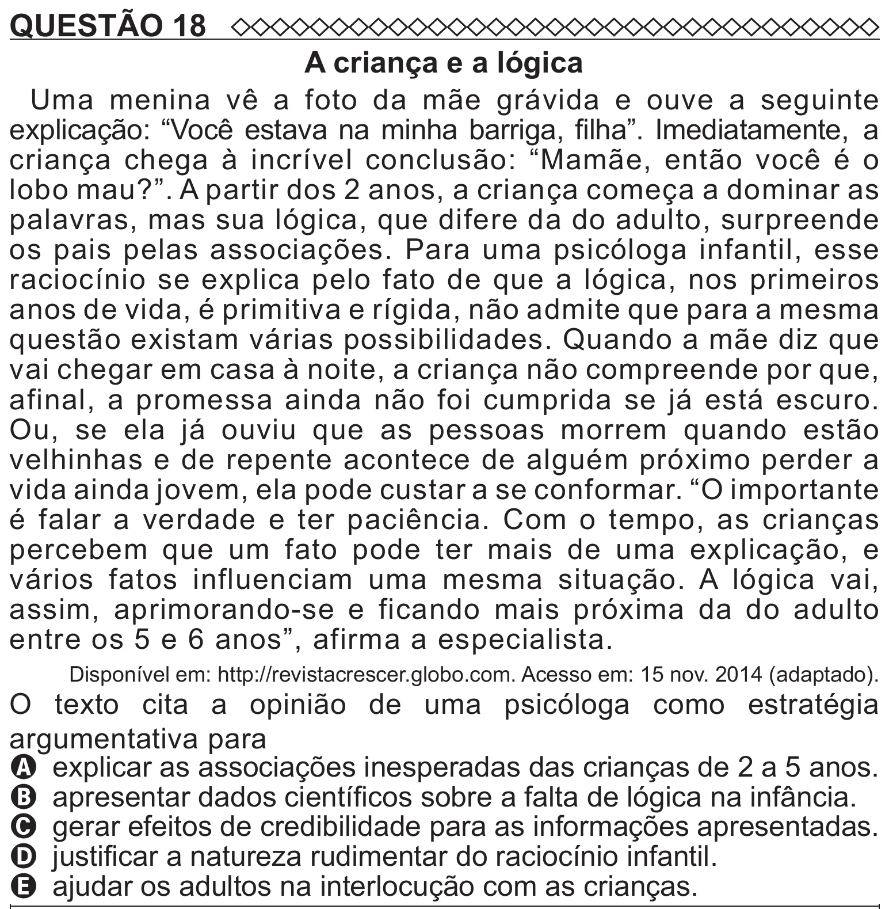

Texto extraído (pode conter ruído)

QUESTÃO 18  
A criança e a lógica  
Uma menina vê a foto da mãe grávida e ouve a seguinte  
explicação: “Você estava na minha barriga, filha”. Imediatamente, a  
criança chega à incrível conclusão: “Mamãe, então você é o  
lobo mau?”. A partir dos 2 anos, a criança começa a dominar as  
palavras, mas sua lógica, que difere da do adulto, surpreende  
os pais pelas associações. Para uma psicóloga infantil, esse  
raciocínio se explica pelo fato de que a lógica, nos primeiros  
anos de vida, é primitiva e rígida, não admite que para a mesma  
questão existam várias possibilidades. Quando a mãe diz que  
vai chegar em casa à noite, a criança não compreende por que,  
afinal, a promessa ainda não foi cumprida se já está escuro.  
Ou, se ela já ouviu que as pessoas morrem quando estão  
velhinhas e de repente acontece de alguém próximo perder a  
vida ainda jovem, ela pode custar a se conformar. “O importante  
é falar a verdade e ter paciência. Com o tempo, as crianças  
percebem que um fato pode ter mais de uma explicação, e  
vários fatos influenciam uma mesma situação. A lógica vai,  
assim, aprimorando-se e ficando mais próxima da do adulto  
entre os 5 e 6 anos”, afirma a especialista.  
Disponível em: http://revistacrescer.globo.com. Acesso em: 15 nov. 2014 (adaptado).  
O texto cita a opinião de uma psicóloga como estratégia  
argumentativa para  
A explicar as associações inesperadas das crianças de 2 a 5 anos.  
B apresentar dados científicos sobre a falta de lógica na infância.  
C gerar efeitos de credibilidade para as informações apresentadas.  
D justificar a natureza rudimentar do raciocínio infantil.  
E ajudar os adultos na interlocução com as crianças.

