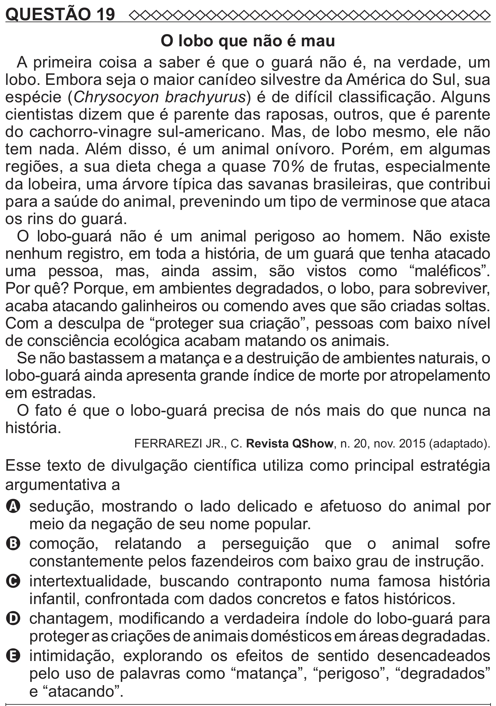

Texto extraído (pode conter ruído)

QUESTÃO 19  
O lobo que não é mau  
A primeira coisa a saber é que o guará não é, na verdade, um  
lobo. Embora seja o maior canídeo silvestre da América do Sul, sua  
espécie (Chrysocyon brachyurus) é de difícil classificação. Alguns  
cientistas dizem que é parente das raposas, outros, que é parente  
do cachorro-vinagre sul-americano. Mas, de lobo mesmo, ele não  
tem nada. Além disso, é um animal onívoro. Porém, em algumas  
regiões, a sua dieta chega a quase 70% de frutas, especialmente  
da lobeira, uma árvore típica das savanas brasileiras, que contribui  
para a saúde do animal, prevenindo um tipo de verminose que ataca  
os rins do guará.  
O lobo-guará não é um animal perigoso ao homem. Não existe  
nenhum registro, em toda a história, de um guará que tenha atacado  
uma pessoa, mas, ainda assim, são vistos como “maléficos”.  
Por quê? Porque, em ambientes degradados, o lobo, para sobreviver,  
acaba atacando galinheiros ou comendo aves que são criadas soltas.  
Com a desculpa de “proteger sua criação”, pessoas com baixo nível  
de consciência ecológica acabam matando os animais.  
Se não bastassem a matança e a destruição de ambientes naturais, o  
lobo-guará ainda apresenta grande índice de morte por atropelamento  
em estradas.  
O fato é que o lobo-guará precisa de nós mais do que nunca na  
história.  
FERRAREZI JR., C. Revista QShow, n. 20, nov. 2015 (adaptado).  
Esse texto de divulgação científica utiliza como principal estratégia  
argumentativa a  
A sedução, mostrando o lado delicado e afetuoso do animal por  
meio da negação de seu nome popular.  
B   
comoção, relatando a perseguição que o animal sofre  
constantemente pelos fazendeiros com baixo grau de instrução.  
C intertextualidade, buscando contraponto numa famosa história  
infantil, confrontada com dados concretos e fatos históricos.  
D chantagem, modificando a verdadeira índole do lobo-guará para  
proteger as criações de animais domésticos em áreas degradadas.  
E   
intimidação, explorando os efeitos de sentido desencadeados  
pelo uso de palavras como “matança”, “perigoso”, “degradados”  
e “atacando”.

