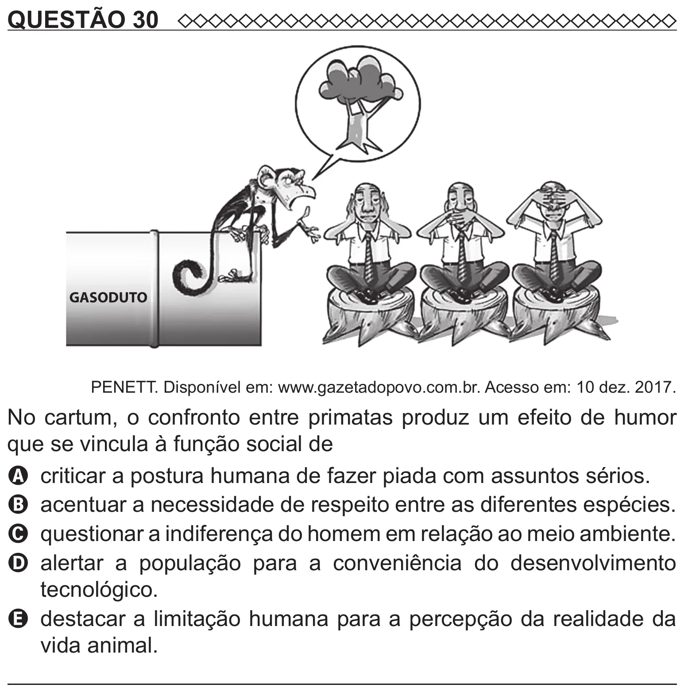

Texto extraído (pode conter ruído)

QUESTÃO 30  
GASODUTO  
PENETT. Disponível em: www.gazetadopovo.com.br. Acesso em: 10 dez. 2017.  
No cartum, o confronto entre primatas produz um efeito de humor  
que se vincula à função social de  
A criticar a postura humana de fazer piada com assuntos sérios.  
B acentuar a necessidade de respeito entre as diferentes espécies.  
C questionar a indiferença do homem em relação ao meio ambiente.  
D   
alertar a população para a conveniência do desenvolvimento  
tecnológico.  
E destacar a limitação humana para a percepção da realidade da  
vida animal.

