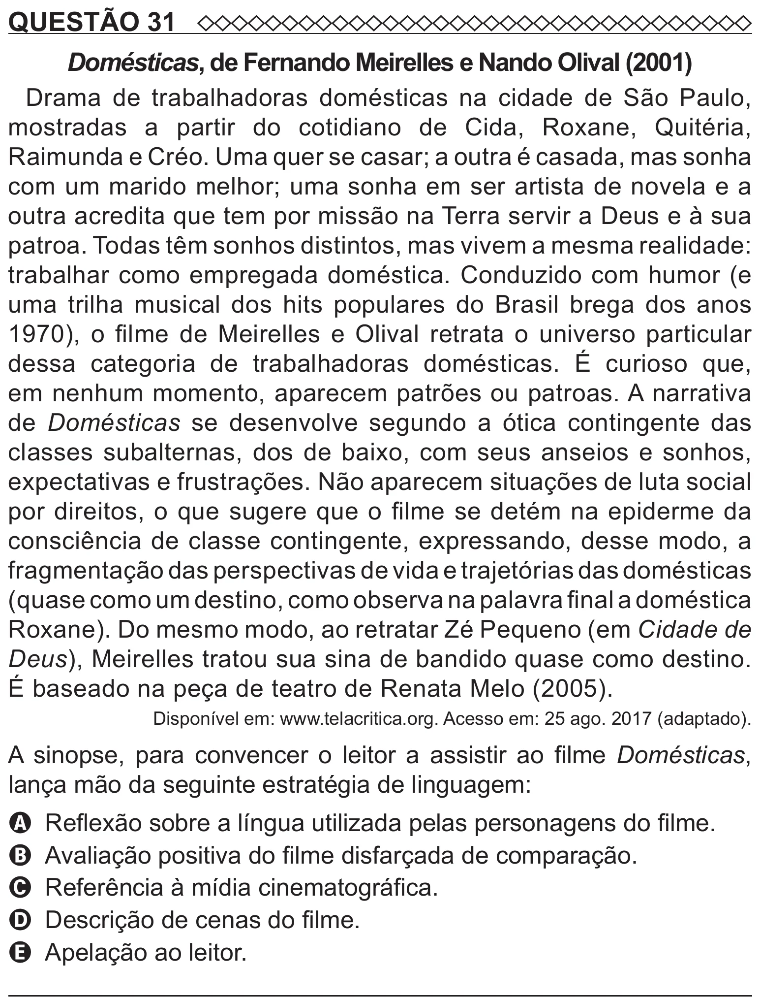

Texto extraído (pode conter ruído)

QUESTÃO 31  
Domésticas, de Fernando Meirelles e Nando Olival (2001)  
Drama de trabalhadoras domésticas na cidade de São Paulo,  
mostradas a partir do cotidiano de Cida, Roxane, Quitéria,  
Raimunda e Créo. Uma quer se casar; a outra é casada, mas sonha  
com um marido melhor; uma sonha em ser artista de novela e a  
outra acredita que tem por missão na Terra servir a Deus e à sua  
patroa. Todas têm sonhos distintos, mas vivem a mesma realidade:  
trabalhar como empregada doméstica. Conduzido com humor (e  
uma trilha musical dos hits populares do Brasil brega dos anos  
1970), o filme de Meirelles e Olival retrata o universo particular  
dessa categoria de trabalhadoras domésticas. É curioso que,  
em nenhum momento, aparecem patrões ou patroas. A narrativa  
de Domésticas se desenvolve segundo a ótica contingente das  
classes subalternas, dos de baixo, com seus anseios e sonhos,  
expectativas e frustrações. Não aparecem situações de luta social  
por direitos, o que sugere que o filme se detém na epiderme da  
consciência de classe contingente, expressando, desse modo, a  
fragmentação das perspectivas de vida e trajetórias das domésticas  
(quase como um destino, como observa na palavra final a doméstica  
Roxane). Do mesmo modo, ao retratar Zé Pequeno (em Cidade de  
Deus), Meirelles tratou sua sina de bandido quase como destino.  
É baseado na peça de teatro de Renata Melo (2005).  
Disponível em: www.telacritica.org. Acesso em: 25 ago. 2017 (adaptado).  
A sinopse, para convencer o leitor a assistir ao filme Domésticas,  
lança mão da seguinte estratégia de linguagem:  
A Reflexão sobre a língua utilizada pelas personagens do filme.  
B Avaliação positiva do filme disfarçada de comparação.  
C Referência à mídia cinematográfica.  
D Descrição de cenas do filme.  
E Apelação ao leitor.

