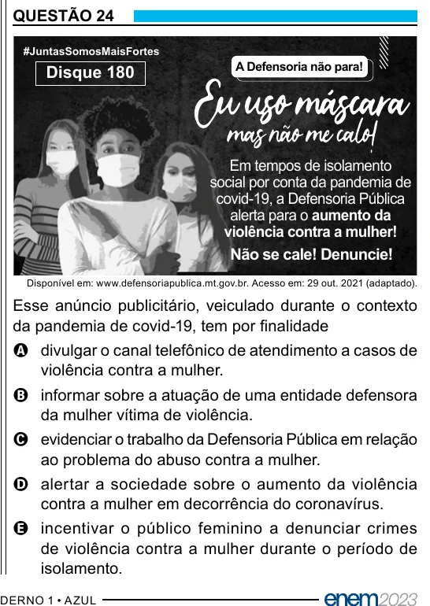

Texto extraído (pode conter ruído)

QUESTÃO 24  
#JuntasSomosMaisFortes  
A Defensoria não para!  
Disque 180  
Em tempos de isolamento  
social por conta da pandemia de  
covid-19, a Defensoria Pública  
alerta para o aumento da  
violência contra a mulher!  
Não se cale! Denuncie!  
Disponível em: www.defensoriapublica.mt.gov.br. Acesso em: 29 out. 2021 (adaptado).  
Esse anúncio publicitário, veiculado durante o contexto  
da pandemia de covid-19, tem por finalidade  
A divulgar o canal telefônico de atendimento a casos de  
violência contra a mulher.  
B informar sobre a atuação de uma entidade defensora  
da mulher vítima de violência.  
C evidenciar o trabalho da Defensoria Pública em relação  
ao problema do abuso contra a mulher.  
D alertar a sociedade sobre o aumento da violência  
contra a mulher em decorrência do coronavírus.  
E incentivar o público feminino a denunciar crimes  
de violência contra a mulher durante o período de  
isolamento.

