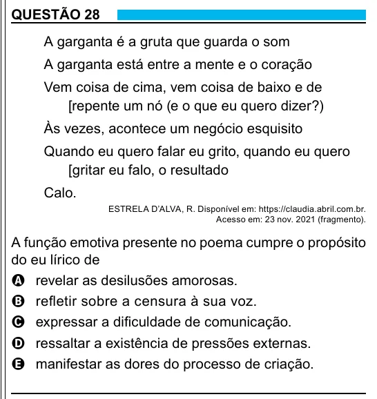

Texto extraído (pode conter ruído)

QUESTÃO 28  
A garganta é a gruta que guarda o som  
A garganta está entre a mente e o coração  
Vem coisa de cima, vem coisa de baixo e de  
[repente um nó (e o que eu quero dizer?)  
Às vezes, acontece um negócio esquisito  
Quando eu quero falar eu grito, quando eu quero  
[gritar eu falo, o resultado  
Calo.  
ESTRELA D’ALVA, R. Disponível em: https://claudia.abril.com.br.  
Acesso em: 23 nov. 2021 (fragmento).  
A função emotiva presente no poema cumpre o propósito  
do eu lírico de  
A revelar as desilusões amorosas.  
B refletir sobre a censura à sua voz.  
C expressar a dificuldade de comunicação.  
D ressaltar a existência de pressões externas.  
E manifestar as dores do processo de criação.  
13

