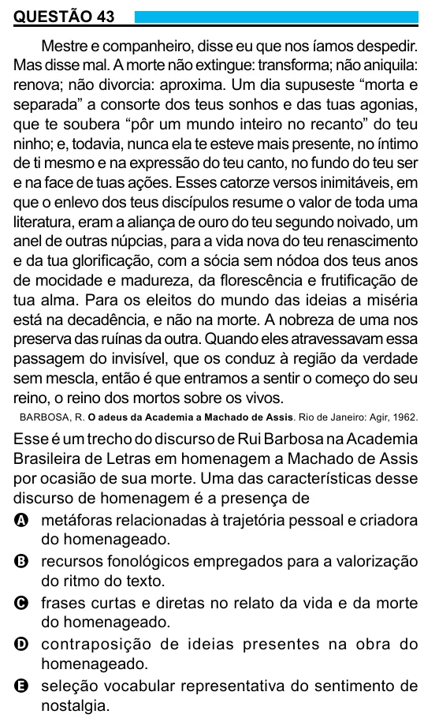

Texto extraído (pode conter ruído)

QUESTÃO 43  
Mestre e companheiro, disse eu que nos íamos despedir.  
Mas disse mal. A morte não extingue: transforma; não aniquila:  
renova; não divorcia: aproxima. Um dia supuseste “morta e  
separada” a consorte dos teus sonhos e das tuas agonias,  
que te soubera “pôr um mundo inteiro no recanto” do teu  
ninho; e, todavia, nunca ela te esteve mais presente, no íntimo  
de ti mesmo e na expressão do teu canto, no fundo do teu ser  
e na face de tuas ações. Esses catorze versos inimitáveis, em  
que o enlevo dos teus discípulos resume o valor de toda uma  
literatura, eram a aliança de ouro do teu segundo noivado, um  
anel de outras núpcias, para a vida nova do teu renascimento  
e da tua glorificação, com a sócia sem nódoa dos teus anos  
de mocidade e madureza, da florescência e frutificação de  
tua alma. Para os eleitos do mundo das ideias a miséria  
está na decadência, e não na morte. A nobreza de uma nos  
preserva das ruínas da outra. Quando eles atravessavam essa  
passagem do invisível, que os conduz à região da verdade  
sem mescla, então é que entramos a sentir o começo do seu  
reino, o reino dos mortos sobre os vivos.  
BARBOSA, R. O adeus da Academia a Machado de Assis. Rio de Janeiro: Agir, 1962.  
Esse é um trecho do discurso de Rui Barbosa na Academia  
Brasileira de Letras em homenagem a Machado de Assis  
por ocasião de sua morte. Uma das características desse  
discurso de homenagem é a presença de  
A metáforas relacionadas à trajetória pessoal e criadora  
do homenageado.  
B recursos fonológicos empregados para a valorização  
do ritmo do texto.  
C frases curtas e diretas no relato da vida e da morte  
do homenageado.  
D contraposição de ideias presentes na obra do  
homenageado.  
E seleção vocabular representativa do sentimento de  
nostalgia.

