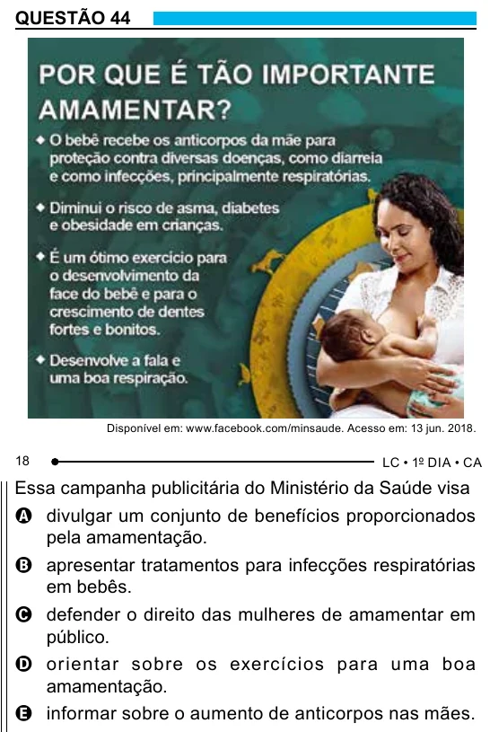

Texto extraído (pode conter ruído)

QUESTÃO 44  
Disponível em: www.facebook.com/minsaude. Acesso em: 13 jun. 2018.  
18  
Essa campanha publicitária do Ministério da Saúde visa  
A divulgar um conjunto de benefícios proporcionados  
pela amamentação.  
B apresentar tratamentos para infecções respiratórias  
em bebês.  
C defender o direito das mulheres de amamentar em  
público.  
D orientar sobre os exercícios para uma boa  
amamentação.  
E informar sobre o aumento de anticorpos nas mães.

