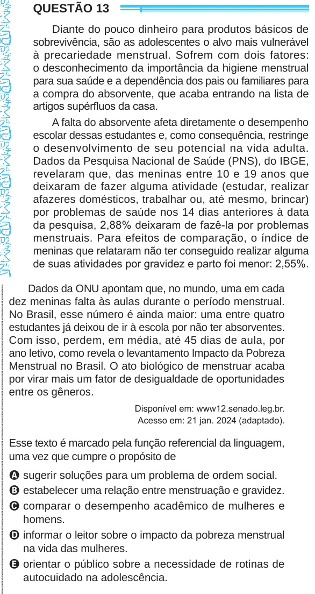

Texto extraído (pode conter ruído)

QUESTÃO 13  
Diante do pouco dinheiro para produtos básicos de  
sobrevivência, são as adolescentes o alvo mais vulnerável  
à precariedade menstrual. Sofrem com dois fatores:  
o desconhecimento da importância da higiene menstrual  
para sua saúde e a dependência dos pais ou familiares para  
a compra do absorvente, que acaba entrando na lista de  
artigos supérfluos da casa.  
A falta do absorvente afeta diretamente o desempenho  
escolar dessas estudantes e, como consequência, restringe  
o desenvolvimento de seu potencial na vida adulta.  
Dados da Pesquisa Nacional de Saúde (PNS), do IBGE,  
revelaram que, das meninas entre 10 e 19 anos que  
deixaram de fazer alguma atividade (estudar, realizar  
afazeres domésticos, trabalhar ou, até mesmo, brincar)  
por problemas de saúde nos 14 dias anteriores à data  
da pesquisa, 2,88% deixaram de fazê-la por problemas  
menstruais. Para efeitos de comparação, o índice de  
meninas que relataram não ter conseguido realizar alguma  
de suas atividades por gravidez e parto foi menor: 2,55%.  
Dados da ONU apontam que, no mundo, uma em cada  
dez meninas falta às aulas durante o período menstrual.  
No Brasil, esse número é ainda maior: uma entre quatro  
estudantes já deixou de ir à escola por não ter absorventes.  
Com isso, perdem, em média, até 45 dias de aula, por  
ano letivo, como revela o levantamento Impacto da Pobreza  
Menstrual no Brasil. O ato biológico de menstruar acaba  
por virar mais um fator de desigualdade de oportunidades  
entre os gêneros.  
Disponível em: www12.senado.leg.br.  
Acesso em: 21 jan. 2024 (adaptado).  
Esse texto é marcado pela função referencial da linguagem,  
uma vez que cumpre o propósito de  
A sugerir soluções para um problema de ordem social.  
B estabelecer uma relação entre menstruação e gravidez.  
C comparar o desempenho acadêmico de mulheres e  
homens.  
D informar o leitor sobre o impacto da pobreza menstrual  
na vida das mulheres.  
E orientar o público sobre a necessidade de rotinas de  
autocuidado na adolescência.

