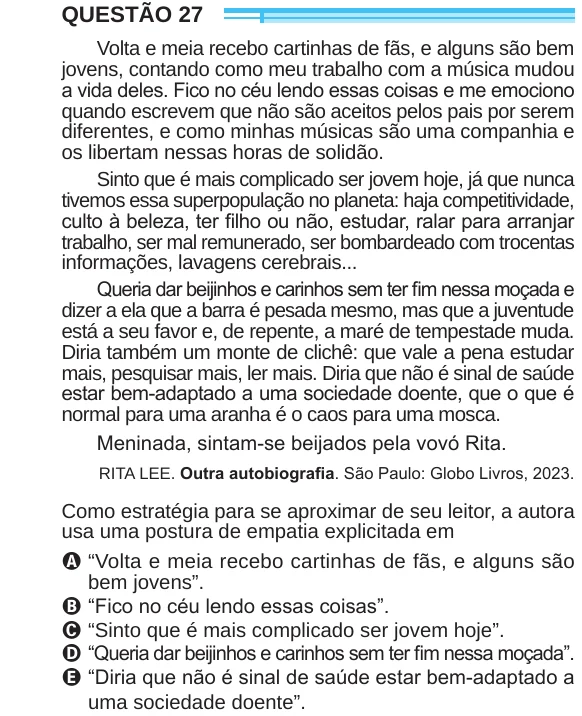

Texto extraído (pode conter ruído)

QUESTÃO 27  
Volta e meia recebo cartinhas de fãs, e alguns são bem  
jovens, contando como meu trabalho com a música mudou  
a vida deles. Fico no céu lendo essas coisas e me emociono  
quando escrevem que não são aceitos pelos pais por serem  
diferentes, e como minhas músicas são uma companhia e  
os libertam nessas horas de solidão.  
Sinto que é mais complicado ser jovem hoje, já que nunca  
tivemos essa superpopulação no planeta: haja competitividade,  
culto à beleza, ter filho ou não, estudar, ralar para arranjar  
trabalho, ser mal remunerado, ser bombardeado com trocentas  
informações, lavagens cerebrais...  
Queria dar beijinhos e carinhos sem ter fim nessa moçada e  
dizer a ela que a barra é pesada mesmo, mas que a juventude  
está a seu favor e, de repente, a maré de tempestade muda.  
Diria também um monte de clichê: que vale a pena estudar  
mais, pesquisar mais, ler mais. Diria que não é sinal de saúde  
estar bem-adaptado a uma sociedade doente, que o que é  
normal para uma aranha é o caos para uma mosca.  
Meninada, sintam-se beijados pela vovó Rita.  
RITA LEE. Outra autobiografia. São Paulo: Globo Livros, 2023.  
Como estratégia para se aproximar de seu leitor, a autora  
usa uma postura de empatia explicitada em  
A “Volta e meia recebo cartinhas de fãs, e alguns são  
bem jovens”.  
B “Fico no céu lendo essas coisas”.  
C “Sinto que é mais complicado ser jovem hoje”.  
D “Queria dar beijinhos e carinhos sem ter fim nessa moçada”.  
E “Diria que não é sinal de saúde estar bem-adaptado a  
uma sociedade doente”.

