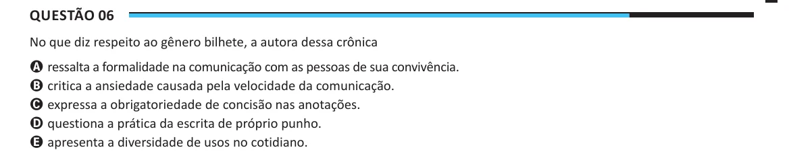

Texto extraído (pode conter ruído)

Questão 06  
No que diz respeito ao gênero bilhete, a autora dessa crônica  
A ressalta a formalidade na comunicação com as pessoas de sua convivência.  
B critica a ansiedade causada pela velocidade da comunicação.  
C expressa a obrigatoriedade de concisão nas anotações.  
D questiona a prática da escrita de próprio punho.  
E apresenta a diversidade de usos no cotidiano.

