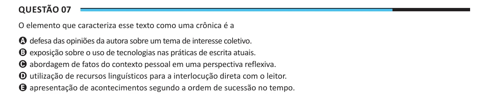

Texto extraído (pode conter ruído)

Questão 07  
O elemento que caracteriza esse texto como uma crônica é a  
A defesa das opiniões da autora sobre um tema de interesse coletivo.  
B exposição sobre o uso de tecnologias nas práticas de escrita atuais.  
C abordagem de fatos do contexto pessoal em uma perspectiva reflexiva.  
D utilização de recursos linguísticos para a interlocução direta com o leitor.  
E apresentação de acontecimentos segundo a ordem de sucessão no tempo.

