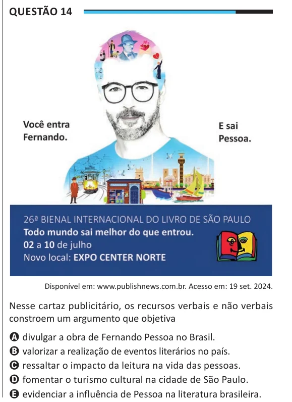

Texto extraído (pode conter ruído)

Questão 14  
Disponível em: www.publishnews.com.br. Acesso em: 19 set. 2024.  
Nesse cartaz publicitário, os recursos verbais e não verbais  
constroem um argumento que objetiva  
A divulgar a obra de Fernando Pessoa no Brasil.  
B valorizar a realização de eventos literários no país.  
C ressaltar o impacto da leitura na vida das pessoas.  
D fomentar o turismo cultural na cidade de São Paulo.  
E evidenciar a influência de Pessoa na literatura brasileira.

