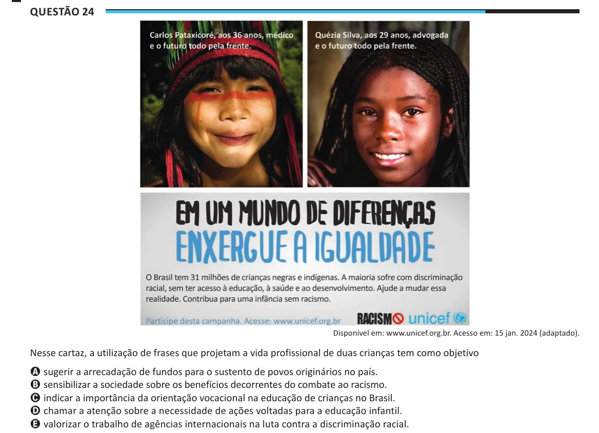

Texto extraído (pode conter ruído)

Questão 24  
Disponível em: www.unicef.org.br. Acesso em: 15 jan. 2024 (adaptado).  
Nesse cartaz, a utilização de frases que projetam a vida profissional de duas crianças tem como objetivo  
A sugerir a arrecadação de fundos para o sustento de povos originários no país.  
B sensibilizar a sociedade sobre os benefícios decorrentes do combate ao racismo.  
C indicar a importância da orientação vocacional na educação de crianças no Brasil.  
D chamar a atenção sobre a necessidade de ações voltadas para a educação infantil.  
E valorizar o trabalho de agências internacionais na luta contra a discriminação racial.

