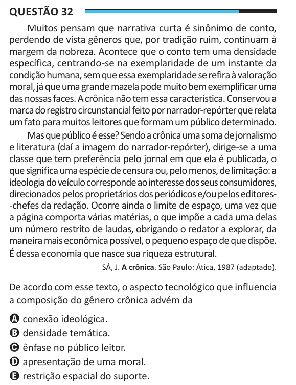

Texto extraído (pode conter ruído)

Questão 32  
Muitos pensam que narrativa curta é sinônimo de conto,  
perdendo de vista gêneros que, por tradição ruim, continuam à  
margem da nobreza. Acontece que o conto tem uma densidade  
específica, centrando-se na exemplaridade de um instante da  
condição humana, sem que essa exemplaridade se refira à valoração  
moral, já que uma grande mazela pode muito bem exemplificar uma  
das nossas faces. A crônica não tem essa característica. Conservou a  
marca do registro circunstancial feito por narrador-repórter que relata  
um fato para muitos leitores que formam um público determinado.  
Mas que público é esse? Sendo a crônica uma soma de jornalismo  
e literatura (daí a imagem do narrador-repórter), dirige-se a uma  
classe que tem preferência pelo jornal em que ela é publicada, o  
que significa uma espécie de censura ou, pelo menos, de limitação: a  
ideologia do veículo corresponde ao interesse dos seus consumidores,  
direcionados pelos proprietários dos periódicos e/ou pelos editores-  
-chefes da redação. Ocorre ainda o limite de espaço, uma vez que  
a página comporta várias matérias, o que impõe a cada uma delas  
um número restrito de laudas, obrigando o redator a explorar, da  
maneira mais econômica possível, o pequeno espaço de que dispõe.  
É dessa economia que nasce sua riqueza estrutural.  
SÁ, J. A crônica. São Paulo: Ática, 1987 (adaptado).  
De acordo com esse texto, o aspecto tecnológico que influencia  
a composição do gênero crônica advém da  
A conexão ideológica.  
B densidade temática.  
C ênfase no público leitor.  
D apresentação de uma moral.  
E restrição espacial do suporte.

