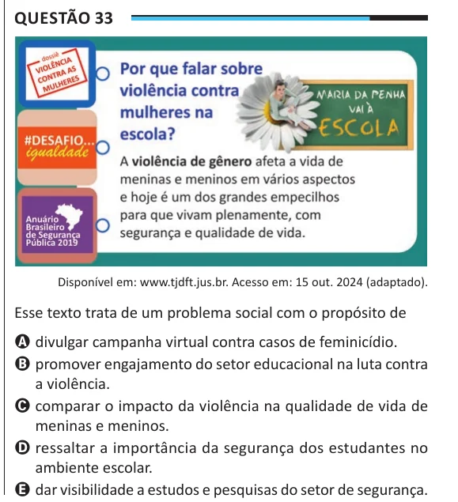

Texto extraído (pode conter ruído)

Questão 33  
Disponível em: www.tjdft.jus.br. Acesso em: 15 out. 2024 (adaptado).  
Esse texto trata de um problema social com o propósito de  
A divulgar campanha virtual contra casos de feminicídio.  
B promover engajamento do setor educacional na luta contra  
a violência.  
C comparar o impacto da violência na qualidade de vida de  
meninas e meninos.  
D ressaltar a importância da segurança dos estudantes no  
ambiente escolar.  
E dar visibilidade a estudos e pesquisas do setor de segurança.

