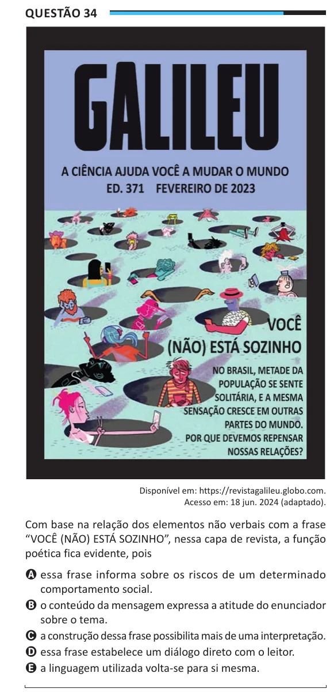

Texto extraído (pode conter ruído)

Questão 34  
Disponível em: https://revistagalileu.globo.com.  
Acesso em: 18 jun. 2024 (adaptado).  
Com base na relação dos elementos não verbais com a frase  
“VOCÊ (NÃO) ESTÁ SOZINHO”, nessa capa de revista, a função  
poética fica evidente, pois  
A essa frase informa sobre os riscos de um determinado  
comportamento social.  
B o conteúdo da mensagem expressa a atitude do enunciador  
sobre o tema.  
C a construção dessa frase possibilita mais de uma interpretação.  
D essa frase estabelece um diálogo direto com o leitor.  
E a linguagem utilizada volta-se para si mesma.

