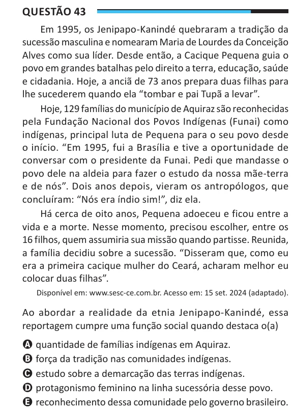

Texto extraído (pode conter ruído)

Questão 43  
Em 1995, os Jenipapo-Kanindé quebraram a tradição da  
sucessão masculina e nomearam Maria de Lourdes da Conceição  
Alves como sua líder. Desde então, a Cacique Pequena guia o  
povo em grandes batalhas pelo direito a terra, educação, saúde  
e cidadania. Hoje, a anciã de 73 anos prepara duas filhas para  
lhe sucederem quando ela “tombar e pai Tupã a levar”.  
Hoje, 129 famílias do município de Aquiraz são reconhecidas  
pela Fundação Nacional dos Povos Indígenas (Funai) como  
indígenas, principal luta de Pequena para o seu povo desde  
o início. “Em 1995, fui a Brasília e tive a oportunidade de  
conversar com o presidente da Funai. Pedi que mandasse o  
povo dele na aldeia para fazer o estudo da nossa mãe-terra  
e de nós”. Dois anos depois, vieram os antropólogos, que  
concluíram: “Nós era índio sim!”, diz ela.  
Há cerca de oito anos, Pequena adoeceu e ficou entre a  
vida e a morte. Nesse momento, precisou escolher, entre os  
16 filhos, quem assumiria sua missão quando partisse. Reunida,  
a família decidiu sobre a sucessão. “Disseram que, como eu  
era a primeira cacique mulher do Ceará, acharam melhor eu  
colocar duas filhas”.  
Disponível em: www.sesc-ce.com.br. Acesso em: 15 set. 2024 (adaptado).  
Ao abordar a realidade da etnia Jenipapo-Kanindé, essa  
reportagem cumpre uma função social quando destaca o(a)  
A quantidade de famílias indígenas em Aquiraz.  
B força da tradição nas comunidades indígenas.  
C estudo sobre a demarcação das terras indígenas.  
D protagonismo feminino na linha sucessória desse povo.  
E reconhecimento dessa comunidade pelo governo brasileiro.

