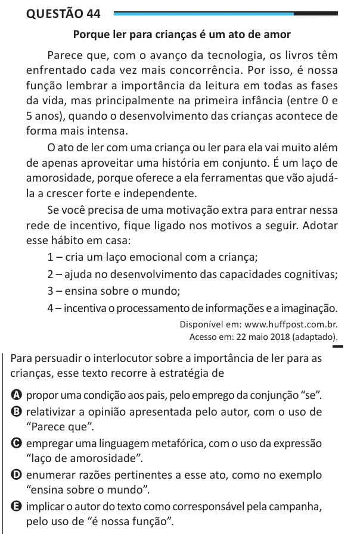

Texto extraído (pode conter ruído)

Questão 44  
Porque ler para crianças é um ato de amor  
Parece que, com o avanço da tecnologia, os livros têm  
enfrentado cada vez mais concorrência. Por isso, é nossa  
função lembrar a importância da leitura em todas as fases  
da vida, mas principalmente na primeira infância (entre 0 e  
5 anos), quando o desenvolvimento das crianças acontece de  
forma mais intensa.  
O ato de ler com uma criança ou ler para ela vai muito além  
de apenas aproveitar uma história em conjunto. É um laço de  
amorosidade, porque oferece a ela ferramentas que vão ajudá-  
la a crescer forte e independente.  
Se você precisa de uma motivação extra para entrar nessa  
rede de incentivo, fique ligado nos motivos a seguir. Adotar  
esse hábito em casa:  
1 – cria um laço emocional com a criança;  
2 – ajuda no desenvolvimento das capacidades cognitivas;  
3 – ensina sobre o mundo;  
4 – incentiva o processamento de informações e a imaginação.  
Disponível em: www.huffpost.com.br.  
Acesso em: 22 maio 2018 (adaptado).  
Para persuadir o interlocutor sobre a importância de ler para as  
crianças, esse texto recorre à estratégia de  
A propor uma condição aos pais, pelo emprego da conjunção “se”.  
B relativizar a opinião apresentada pelo autor, com o uso de  
“Parece que”.  
C empregar uma linguagem metafórica, com o uso da expressão  
“laço de amorosidade”.  
D enumerar razões pertinentes a esse ato, como no exemplo  
“ensina sobre o mundo”.  
E implicar o autor do texto como corresponsável pela campanha,  
pelo uso de “é nossa função”.

