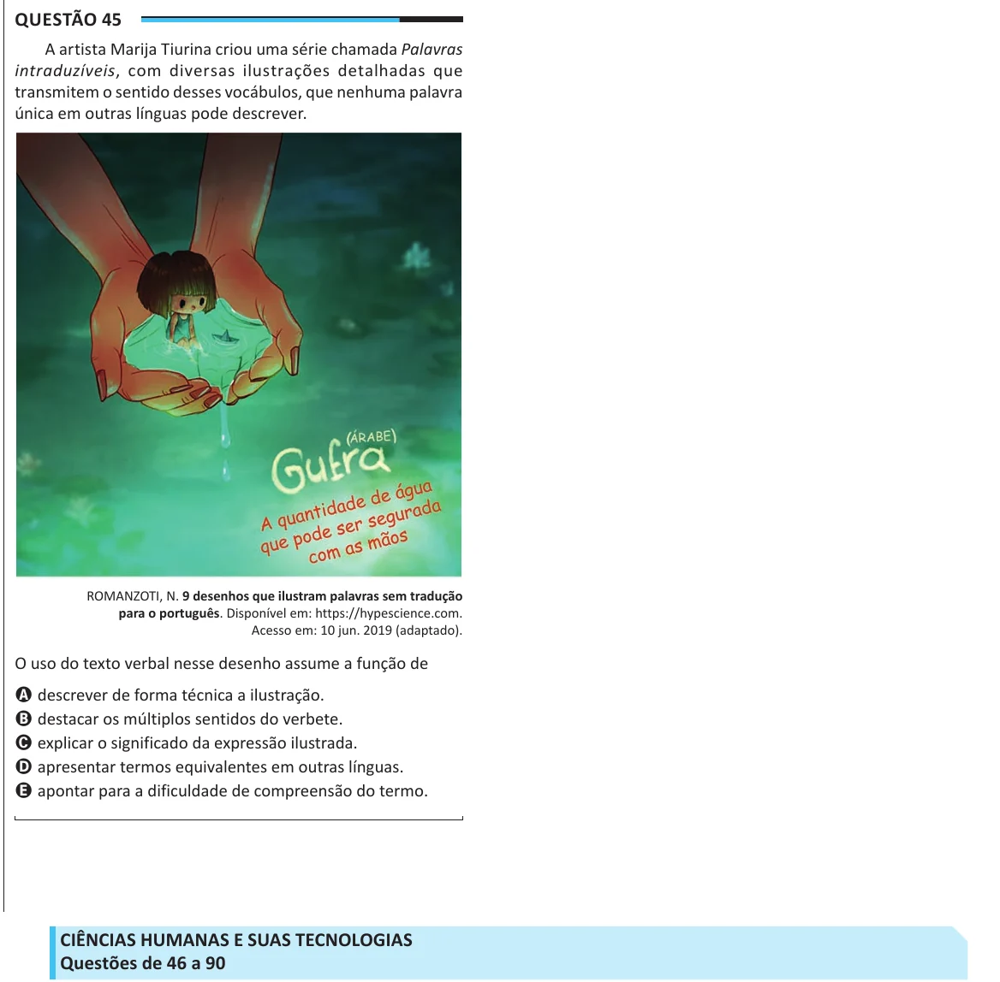

Texto extraído (pode conter ruído)

Questão 45  
A artista Marija Tiurina criou uma série chamada Palavras  
intraduzíveis, com diversas ilustrações detalhadas que  
transmitem o sentido desses vocábulos, que nenhuma palavra  
única em outras línguas pode descrever.  
ROMANZOTI, N. 9 desenhos que ilustram palavras sem tradução  
para o português. Disponível em: https://hypescience.com.  
Acesso em: 10 jun. 2019 (adaptado).  
O uso do texto verbal nesse desenho assume a função de  
A descrever de forma técnica a ilustração.  
B destacar os múltiplos sentidos do verbete.  
C explicar o significado da expressão ilustrada.  
D apresentar termos equivalentes em outras línguas.  
E apontar para a dificuldade de compreensão do termo.  
CIÊNCIAS HUMANAS E SUAS TECNOLOGIAS  
Questões de 46 a 90

