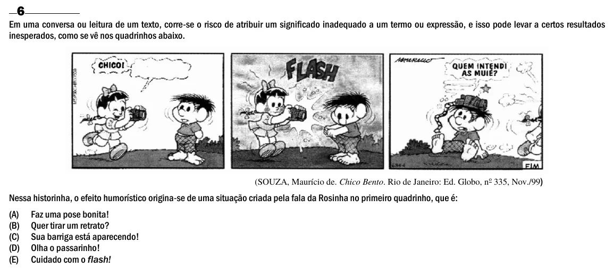

Texto extraído (pode conter ruído)

6  
Em uma conversa ou leitura de um texto, corre-se o risco de atribuir um significado inadequado a um termo ou expressão, e isso pode levar a certos resultados  
inesperados, como se vê nos quadrinhos abaixo.  
(SOUZA, Maurício de. Chico Bento. Rio de Janeiro: Ed. Globo, n o 335, Nov./99 )  
Nessa historinha, o efeito humorístico origina-se de uma situação criada pela fala da Rosinha no primeiro quadrinho, que é:  
(A)  
Faz uma pose bonita!  
(B)  
Quer tirar um retrato?  
(C)  
Sua barriga está aparecendo!  
(D)  
Olha o passarinho!  
(E)  
Cuidado com o flash!

