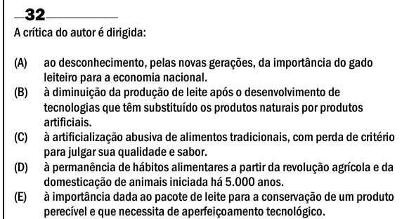

Texto extraído (pode conter ruído)

32  
A crítica do autor é dirigida:  
(A)  
ao desconhecimento, pelas novas gerações, da importância do gado  
leiteiro para a economia nacional.  
(B)  
à diminuição da produção de leite após o desenvolvimento de  
tecnologias que têm substituído os produtos naturais por produtos  
artificiais.  
(C)  
à artificialização abusiva de alimentos tradicionais, com perda de critério  
para julgar sua qualidade e sabor.  
(D)  
à permanência de hábitos alimentares a partir da revolução agrícola e da  
domesticação de animais iniciada há 5.000 anos.  
(E)  
à importância dada ao pacote de leite para a conservação de um produto  
perecível e que necessita de aperfeiçoamento tecnológico.

