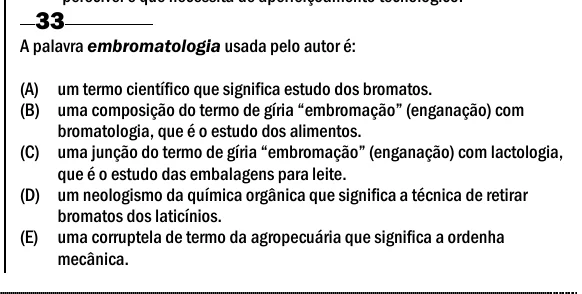

Texto extraído (pode conter ruído)

33  
A palavra embromatologia usada pelo autor é:  
(A) um termo científico que significa estudo dos bromatos.  
(B) uma composição do termo de gíria “embromação” (enganação) com  
bromatologia, que é o estudo dos alimentos.  
(C) uma junção do termo de gíria “embromação” (enganação) com lactologia,  
que é o estudo das embalagens para leite.  
(D) um neologismo da química orgânica que significa a técnica de retirar  
bromatos dos laticínios.  
(E) uma corruptela de termo da agropecuária que significa a ordenha  
mecânica.

