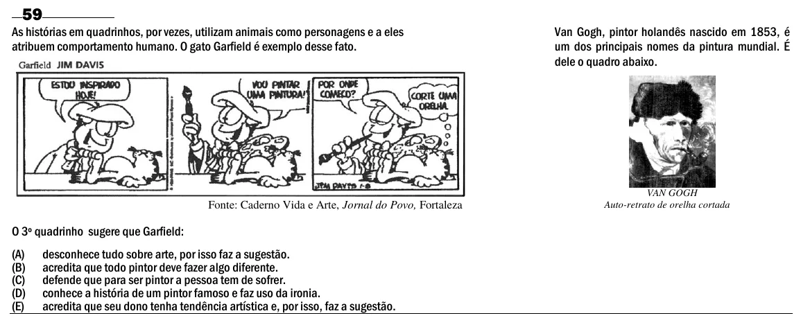

Texto extraído (pode conter ruído)

59  
As histórias em quadrinhos, por vezes, utilizam animais como personagens e a eles  
Van Gogh, pintor holandês nascido em 1853, é  
atribuem comportamento humano. O gato Garfield é exemplo desse fato.  
um dos principais nomes da pintura mundial. É  
dele o quadro abaixo.  
VAN GOGH  
Fonte: Caderno Vida e Arte, Jornal do Povo, Fortaleza  
Auto-retrato de orelha cortada  
O 3º quadrinho sugere que Garfield:  
(A)  
desconhece tudo sobre arte, por isso faz a sugestão.  
(B)  
acredita que todo pintor deve fazer algo diferente.  
(C)  
defende que para ser pintor a pessoa tem de sofrer.  
(D)  
conhece a história de um pintor famoso e faz uso da ironia.  
(E)  
acredita que seu dono tenha tendência artística e, por isso, faz a sugestão.

