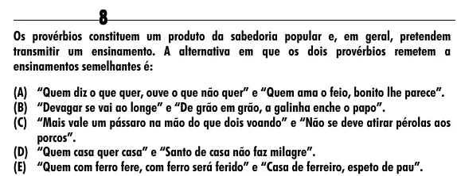

Texto extraído (pode conter ruído)

8  
Os provérbios constituem um produto da sabedoria popular e, em geral, pretendem  
transmitir um ensinamento. A alternativa em que os dois provérbios remetem a  
ensinamentos semelhantes é:  
(A) “Quem diz o que quer, ouve o que não quer” e “Quem ama o feio, bonito lhe parece”.  
(B) “Devagar se vai ao longe” e “De grão em grão, a galinha enche o papo”.  
(C) “Mais vale um pássaro na mão do que dois voando” e “Não se deve atirar pérolas aos  
porcos”.  
(D) “Quem casa quer casa” e “Santo de casa não faz milagre”.  
(E) “Quem com ferro fere, com ferro será ferido” e “Casa de ferreiro, espeto de pau”.

