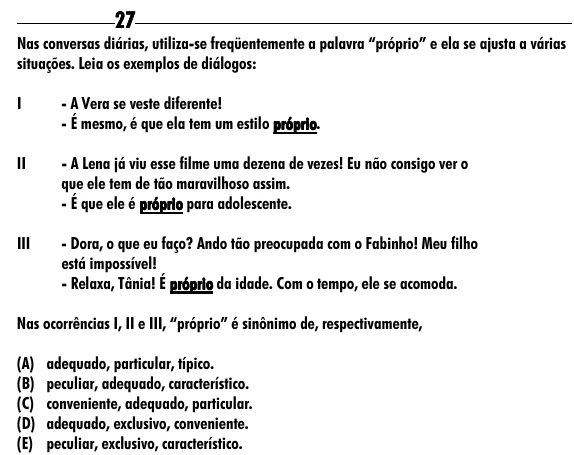

Texto extraído (pode conter ruído)

27  
Nas conversas diárias, utiliza-se freqüentemente a palavra “próprio” e ela se ajusta a várias  
situações. Leia os exemplos de diálogos:  
I  
- A Vera se veste diferente!  
- É mesmo, é que ela tem um estilo próprio.  
próprio  
II  
- A Lena já viu esse filme uma dezena de vezes! Eu não consigo ver o  
que ele tem de tão maravilhoso assim.  
- É que ele é próprio para adolescente.  
III  
- Dora, o que eu faço? Ando tão preocupada com o Fabinho! Meu filho  
está impossível!  
- Relaxa, Tânia! É próprio da idade. Com o tempo, ele se acomoda.  
Nas ocorrências I, II e III, “próprio” é sinônimo de, respectivamente,  
(A) adequado, particular, típico.  
(B) peculiar, adequado, característico.  
(C) conveniente, adequado, particular.  
(D) adequado, exclusivo, conveniente.  
(E) peculiar, exclusivo, característico.

