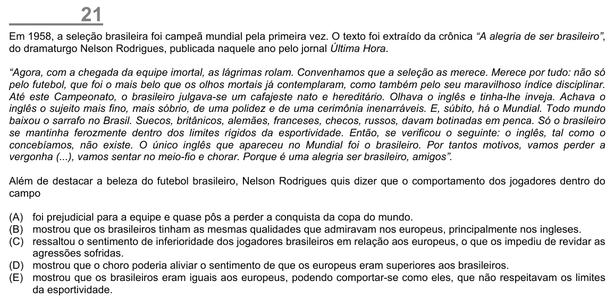

Texto extraído (pode conter ruído)

21  
Em 1958, a seleção brasileira foi campeã mundial pela primeira vez. O texto foi extraído da crônica “A alegria de ser brasileiro”,  
do dramaturgo Nelson Rodrigues, publicada naquele ano pelo jornal Última Hora.  
“Agora, com a chegada da equipe imortal, as lágrimas rolam. Convenhamos que a seleção as merece. Merece por tudo: não só  
pelo futebol, que foi o mais belo que os olhos mortais já contemplaram, como também pelo seu maravilhoso índice disciplinar.  
Até este Campeonato, o brasileiro julgava-se um cafajeste nato e hereditário. Olhava o inglês e tinha-lhe inveja. Achava o  
inglês o sujeito mais fino, mais sóbrio, de uma polidez e de uma cerimônia inenarráveis. E, súbito, há o Mundial. Todo mundo  
baixou o sarrafo no Brasil. Suecos, britânicos, alemães, franceses, checos, russos, davam botinadas em penca. Só o brasileiro  
se mantinha ferozmente dentro dos limites rígidos da esportividade. Então, se verificou o seguinte: o inglês, tal como o  
concebíamos, não existe. O único inglês que apareceu no Mundial foi o brasileiro. Por tantos motivos, vamos perder a  
vergonha (...), vamos sentar no meio-fio e chorar. Porque é uma alegria ser brasileiro, amigos”.  
Além de destacar a beleza do futebol brasileiro, Nelson Rodrigues quis dizer que o comportamento dos jogadores dentro do  
campo  
(A) foi prejudicial para a equipe e quase pôs a perder a conquista da copa do mundo.  
(B) mostrou que os brasileiros tinham as mesmas qualidades que admiravam nos europeus, principalmente nos ingleses.  
(C) ressaltou o sentimento de inferioridade dos jogadores brasileiros em relação aos europeus, o que os impediu de revidar as  
agressões sofridas.  
(D) mostrou que o choro poderia aliviar o sentimento de que os europeus eram superiores aos brasileiros.  
(E) mostrou que os brasileiros eram iguais aos europeus, podendo comportar-se como eles, que não respeitavam os limites  
da esportividade.

